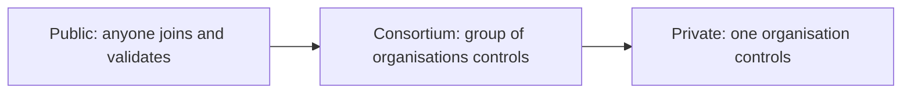

**In simple words:** blockchains differ by who is allowed to join and control them. Public is open to all, private belongs to one owner and consortium is shared by a group.

**Types:** <Cite id="class-bt-m1" loc="slide 43" /> <Cite id="blockchain-fundamentals-gfg-types" />

1. **Public.** No one is in charge; anyone with a computer and internet can read, write and audit. **Example:** Bitcoin, Ethereum. <Cite id="class-bt-m1" loc="slide 53" />
2. **Private.** Owned by one person or organisation that decides who may read or write; fast and private but less decentralised. **Example:** a bank chain, Hyperledger. <Cite id="class-bt-m1" loc="slide 58" />
3. **Consortium (federated).** More than one organisation in charge; a group of companies decides together. **Example:** R3, Energy Web Foundation. <Cite id="class-bt-m1" loc="slide 66" />

| Point | Public | Private | Consortium |
|---|---|---|---|
| Access | Open to all | Invite only | Approved members |
| Control | No one | One organisation | Group of organisations |
| Decentralisation | Highest | Lowest | Partial |
| Speed | Slow | Fast | Fast |
| Privacy | Low | High | Medium to high |
| Consensus | PoW, PoS | PBFT, Raft, PoA | PBFT, Raft, IBFT |
| Energy | High | Low | Low |
| Examples | Bitcoin, Ethereum | Internal bank ledger | Fabric, Corda |

<Cite id="private-blockchain-gfg-pubpriv" />

**Extend in the exam (add these to reach 10 marks):**

- **Advantages and disadvantages.** Public: trustable, secure, decentralised, but slow and energy hungry. <Cite id="class-bt-m1" loc="slide 55" /> Private: fast, scalable, private, but centralised and easier to manipulate. <Cite id="class-bt-m1" loc="slide 59" /> Consortium: speed and shared authority, but members must agree and a few corrupt nodes hurt. <Cite id="class-bt-m1" loc="slide 67" />
- **Permissionless and permissioned.** The same idea seen by "who may take part". <Cite id="class-bt-m1" loc="slide 43" />
- **Hybrid.** A mix: part private, part public; example Ripple. <Cite id="class-bt-m1" loc="slide 62" />
- **Use cases.** Public for crypto and dApps; private for internal audit; consortium for banks and supply chains. <Cite id="private-blockchain-gfg-consortium" />

**Conclusion:** choose public for openness, private for control and speed, consortium for shared control between businesses.
