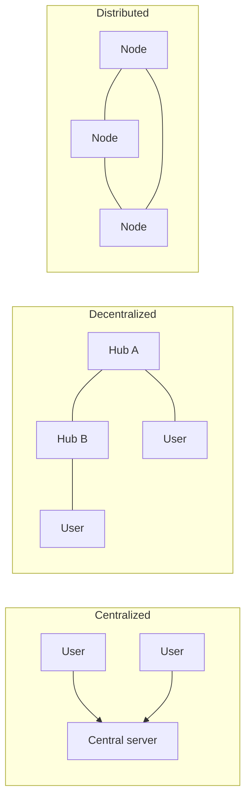

**In simple words:** in a centralized system one boss decides, in a decentralized system several bosses share control and in a distributed system many computers share the work and data.

1. **Centralized system.** One central server or authority stores the data and takes decisions; users only ask it. **Example:** a bank's database. Weak point: if it fails or is hacked, everything stops. <Cite id="class-bt-m1" loc="slide 4" /> <Cite id="web-bt-sol-a-gfg-cdd" />
2. **Decentralized system.** Control is shared by several independent nodes or hubs, with no single owner of the whole. **Example:** a public blockchain. <Cite id="class-bt-m1" loc="slide 19" />
3. **Distributed system.** Data and processing are spread over many computers in different places that act as one system. **Example:** the Bitcoin ledger copied on every node. <Cite id="web-bt-sol-a-wiki-distcomp" /> <Cite id="class-bt-m1" loc="slide 5" />

| Point | Centralized | Decentralized | Distributed |
|---|---|---|---|
| Control | One authority | Several nodes | Spread over all nodes |
| Data | One place | Several hubs | Many machines |
| Failure | Single point of failure | Part fails | Survives many failures |
| Speed | Fast and simple | Medium | Harder to keep in step |
| Trust | The owner | No single party | The rules |

<Cite id="web-bt-sol-a-gfg-dist-dec" />

**Extend in the exam (add these to reach 10 marks):**

- **Distributed is not always decentralized.** A company's cloud database is distributed but one company controls it; Bitcoin is both.
- **Storage example.** Centralized storage depends on one provider; decentralized storage on many nodes. <Cite id="class-bt-m3b" loc="slide 28" />
- **Advantages and disadvantages.** Centralized: simple, fast, but single point of failure and censorship. Distributed: fault tolerant and scalable, but complex and slower to agree.
- **Blockchain link.** A blockchain is a distributed ledger with decentralized control, using consensus to agree.

**Conclusion:** blockchain moves from a centralized record keeper to a distributed, decentralized ledger that nobody alone controls.
