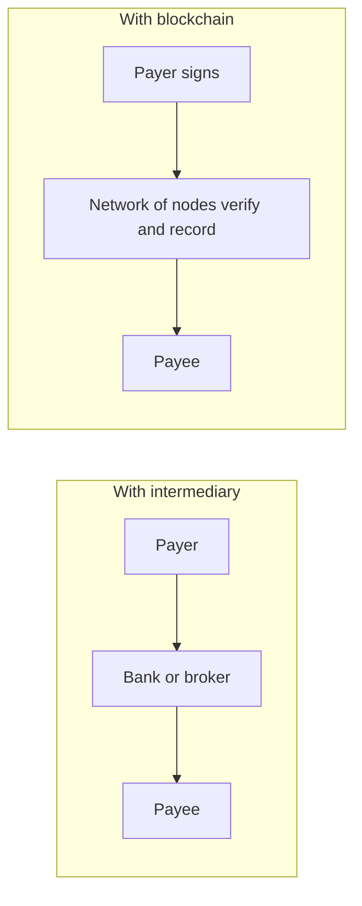

**In simple words:** an intermediary is a middleman such as a bank or broker. Blockchain lets two people deal directly because the network itself checks and records the deal.

1. **Peer-to-peer value transfer.** Users send value as simply as sending an SMS, with no central party to confirm it. <Cite id="class-bt-m1" loc="slide 22" /> **Example:** sending Bitcoin without a bank. <Cite id="class-bt-m2" loc="slide 108" />
2. **Cryptography replaces trust.** The sender signs with a private key and the network checks with the public key. <Cite id="class-bt-m2" loc="slide 117" />
3. **Consensus replaces the clearing house.** Miners agree on the next block, so no central body approves payments. <Cite id="class-bt-m2" loc="slide 29" />
4. **Shared ledger replaces separate books.** All nodes hold one copy, so nothing needs reconciling.
5. **Smart contracts replace brokers and agents.** Agreements run automatically; this reduces banks, brokers and agents. <Cite id="class-bt-m3a" loc="slide 48" />
6. **Results.** Lower cost, faster settlement, fewer errors and less paperwork. <Cite id="web-bt-sol-a-gfg-complete" />

| Point | With intermediary | With blockchain |
|---|---|---|
| Verifier | Bank, broker, notary | Network of nodes |
| Cost | Fee at each step | Small network fee |
| Time | Days | Minutes to hours |
| Records | Separate books | One shared ledger |
| Trust | In the institution | In code and consensus |

<Cite id="web-bt-sol-a-wiki-disint" />

**Extend in the exam (add these to reach 10 marks):**

- **Applications.** Banking and cross-border payment, supply chain, healthcare, voting, real estate. <Cite id="class-bt-m1" loc="slide 6" />
- **Fraud reduction.** Immutable, time-stamped records are hard to forge. <Cite id="class-bt-m1" loc="slide 105" />
- **Bitcoin idea.** Nakamoto proposed payment "based on cryptographic proof instead of trust". <Cite id="blockchain-fundamentals-nakamoto" loc="§1" />
- **Limits.** New middlemen appear (exchanges, wallets, oracles) and trust moves to code.

**Conclusion:** blockchain removes the need to trust a middleman by making the network the verifier.
