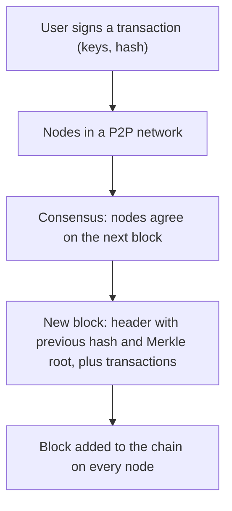

**In simple words:** a blockchain is built from a few parts that work together: nodes keep the ledger, transactions fill blocks, hashes link the blocks and consensus decides the next block.

1. **Node.** A computer that keeps a copy of the ledger and follows the rules; full nodes verify everything, light nodes keep little. **Example:** a Bitcoin full node. <Cite id="class-bt-m1" loc="slide 22" />
2. **Transaction.** The basic record, such as "A pays B 2 coins", hashed to a transaction ID. <Cite id="class-bt-m1" loc="slide 33" />
3. **Block.** A header (version, previous hash, timestamp, nonce, nBits, Merkle root) plus a body (transaction counter and transactions). <Cite id="class-bt-m1" loc="slide 70" />
4. **Chain.** Each block stores the previous block's hash, which links the blocks. <Cite id="class-bt-m1" loc="slide 103" />
5. **Hash function and cryptography.** Hashing gives integrity; private and public keys give signatures and ownership. <Cite id="class-bt-m1" loc="slide 32" />
6. **Distributed ledger (P2P network).** Every node holds the same copy. <Cite id="class-bt-m1" loc="slide 20" />
7. **Consensus mechanism.** The rule to agree on the next block, for example Proof of Work. <Cite id="class-bt-m1" loc="slide 36" />
8. **Smart contracts.** Code on the chain that runs agreements automatically. <Cite id="class-bt-m1" loc="slide 42" />

| Component | Role |
|---|---|
| Node | Stores and checks the ledger |
| Block | Container of transactions |
| Hash | Fingerprint, links blocks |
| Consensus | Agreement on the next block |
| Smart contract | Automatic agreement |

<Cite id="blockchain-fundamentals-tp-intro" />

**Extend in the exam (add these to reach 10 marks):**

- **Header fields in short.** Version, previous hash, timestamp, nonce, nBits, Merkle root. <Cite id="block-structure-merkle-mb-ch11" />
- **Merkle tree.** Summarises all transactions in the header. 
- **Miner.** Adds new blocks and checks them. <Cite id="class-bt-m1" loc="slide 22" />
- **Why this design.** Tamper detection, light clients, append-only history. <Cite id="blockchain-fundamentals-gfg-structure" />

**Conclusion:** nodes, transactions, blocks, hashes, consensus and contracts together make a tamper-resistant shared ledger.
