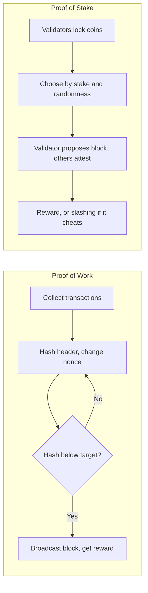

**In simple words:** both are rules to choose who adds the next block. In Proof of Work you win by doing heavy computing; in Proof of Stake you win by locking up coins.

1. **Proof of Work (PoW).** Miners change a nonce and hash the block header until the hash is below a target; the first to find it adds the block and gets the reward. The principle: hard to find, easy to verify. <Cite id="class-bt-m2" loc="slide 27" /> <Cite id="class-bt-m2" loc="slide 30" /> **Example:** Bitcoin.
2. **Proof of Stake (PoS).** Users lock (stake) coins and become validators; one is chosen by stake amount, randomness or coin age to verify transactions and add a block. If the block is accepted, the validator gets stake and reward back; if not, it loses the stake. <Cite id="class-bt-m2" loc="slide 42" /> <Cite id="class-bt-m2" loc="slide 45" /> **Example:** Ethereum since 2022. <Cite id="consensus-mining-eth-pos" />

| Point | PoW | PoS |
|---|---|---|
| Who creates blocks | Miners | Validators |
| Resource | Hardware and electricity | Locked coins |
| Energy | Very high | Very low |
| Penalty for cheating | Wasted work | Loss of stake |
| Attack cost | 51% of hash power | 51% of stake |
| Example | Bitcoin | Ethereum |

<Cite id="consensus-mining-gfg-crypto-consensus" />

**Extend in the exam (add these to reach 10 marks):**

- **Advantages of PoW.** Proven and reliable, secure. **Disadvantages.** High energy, centralisation risk, high fees, 51% attack risk. <Cite id="class-bt-m2" loc="slide 37" /> <Cite id="class-bt-m2" loc="slide 41" />
- **Advantages of PoS.** Energy efficient, more decentralised, secure because 51% of stake is expensive. <Cite id="class-bt-m2" loc="slide 47" />
- **PoS weakness.** The nothing-at-stake problem. <Cite id="class-bt-m2" loc="slide 49" />
- **Ethereum Merge.** Moved from PoW to PoS in 2022 and cut energy use by about 99.9%. <Cite id="consensus-mining-eth-merge" />

**Conclusion:** PoW is proven but costly; PoS saves energy but lets wealth give power.
