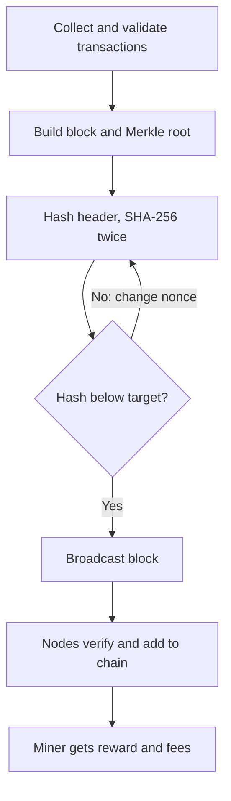

**In simple words:** mining is the work miners do to check payments and add them to the blockchain. Difficulty is how hard the puzzle is, and Bitcoin adjusts it so a block arrives about every 10 minutes.

**Definition:** Bitcoin mining is the process of verifying bitcoin transactions and storing them in the blockchain (ledger); it also creates new bitcoin as a reward. <Cite id="class-bt-m2" loc="slide 123" />

**Mining process:** <Cite id="class-bt-m2" loc="slide 30" /> <Cite id="class-bt-m2" loc="slide 80" />

1. **Receive transactions** from the mempool.
2. **Verify** signatures and balance; reject invalid ones.
3. **Create a block** with previous hash, timestamp and Merkle root.
4. **Solve the puzzle.** Change the nonce until hash(block header) is below the target.
5. **Broadcast** the block when found.
6. **Other nodes verify** and add it to the chain.
7. **Reward.** Block reward plus transaction fees. <Cite id="class-bt-m2" loc="slide 82" />

**Mining difficulty adjustment:** <Cite id="class-bt-m2" loc="slide 92" /> <Cite id="class-bt-m2" loc="slide 93" />

1. Bitcoin checks after every **2016 blocks** (about 2 weeks).
2. Expected time is 2016 x 10 minutes = 14 days; compare with the actual time.
3. Too fast, so difficulty goes up; too slow, so it goes down.
4. Difficulty = difficulty_1_target / current_target; a smaller target is harder. <Cite id="class-bt-m2" loc="slide 94" />

New difficulty = old difficulty x 14 days / actual time. **Example:** blocks took 10 days, so difficulty x 1.4.

| Situation | Effect |
|---|---|
| More miners, faster blocks | Difficulty rises |
| Fewer miners, slower blocks | Difficulty falls |

**Extend in the exam (add these to reach 10 marks):**

- **Limit.** One change is at most a factor of 4. <Cite id="bitcoin-btcwiki-difficulty" />
- **Expected work.** About difficulty x 2^32 hashes per block. <Cite id="web-bt-1-target" />
- **Pros and cons.** Keeps block time and security steady, but needs huge energy. <Cite id="class-bt-m2" loc="slide 96" />
- **Mining pools.** Small miners share work and reward (PPS, PPLNS, FPPS). <Cite id="class-bt-m2" loc="slide 98" />
- **Halving.** The reward halves every 210,000 blocks. 

**Conclusion:** mining secures Bitcoin and difficulty keeps the block rate steady whatever the total hash power. <Cite id="bitcoin-mb-ch12-mining" />
