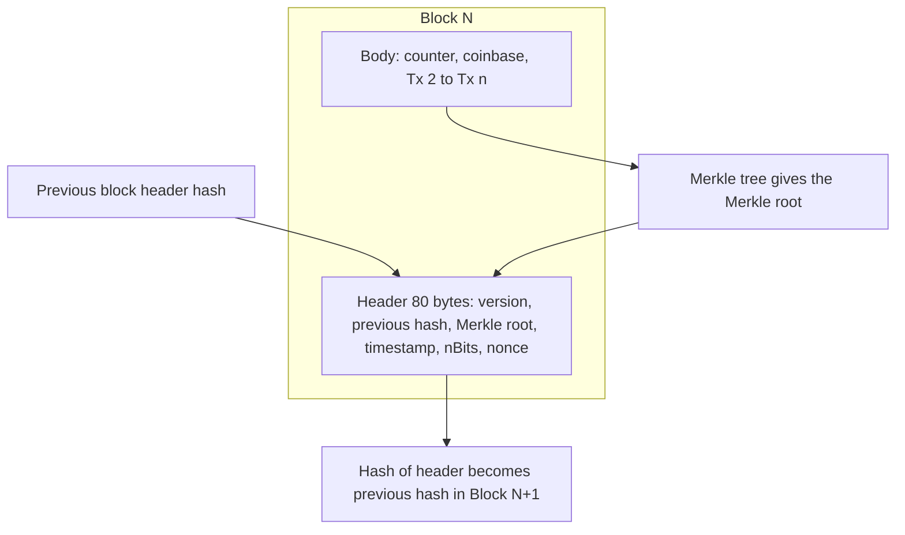

**In simple words:** a block is a box with a small label (the header) and a list of transactions (the body). The label links the block to the one before it.

**Block structure:** a block has two parts, the **header** (metadata) and the **body** (transactions). <Cite id="class-bt-m1" loc="slide 69" />

**Header fields (80 bytes in Bitcoin):** <Cite id="class-bt-m1" loc="slide 70" />

1. **Version** (4 bytes). Which validation rules apply; used in upgrades. <Cite id="class-bt-m1" loc="slide 72" />
2. **Previous (parent) block hash** (32 bytes). Links this block to the one before it. <Cite id="class-bt-m1" loc="slide 74" />
3. **Merkle root** (32 bytes). One hash summarising all transactions. <Cite id="class-bt-m1" loc="slide 80" />
4. **Timestamp** (4 bytes). Approximate time of the block. <Cite id="class-bt-m1" loc="slide 75" />
5. **nBits** (4 bytes). Compressed difficulty target. <Cite id="class-bt-m1" loc="slide 79" />
6. **Nonce** (4 bytes). Number miners change to find a valid hash. <Cite id="class-bt-m1" loc="slide 76" />

**Body:** a transaction counter and the transaction list; the first is the coinbase paying the miner. <Cite id="class-bt-m1" loc="slide 83" />

| Field | Size | Purpose |
|---|---|---|
| Version | 4 B | Rules |
| Previous hash | 32 B | Chain link |
| Merkle root | 32 B | Transactions summary |
| Timestamp | 4 B | Time |
| nBits | 4 B | Difficulty |
| Nonce | 4 B | Mining |

<Cite id="block-structure-merkle-devref" />

**Extend in the exam (add these to reach 10 marks):**

- **Block hash.** SHA-256 applied twice to the 80-byte header; the next block stores it. <Cite id="web-bt-1-block-hashing" /> <Cite id="class-bt-m1" loc="slide 89" />
- **Block height.** Genesis is height 0; each block is one higher. <Cite id="class-bt-m1" loc="slide 94" />
- **Why chained.** Change a block and every later link breaks. <Cite id="class-bt-m1" loc="slide 105" />
- **Size.** About 1 MB base limit (up to about 4 MB weight with SegWit). <Cite id="block-structure-merkle-btcwiki-block" />

**Conclusion:** the header links blocks, the Merkle root protects the transactions and the nonce proves the work.
