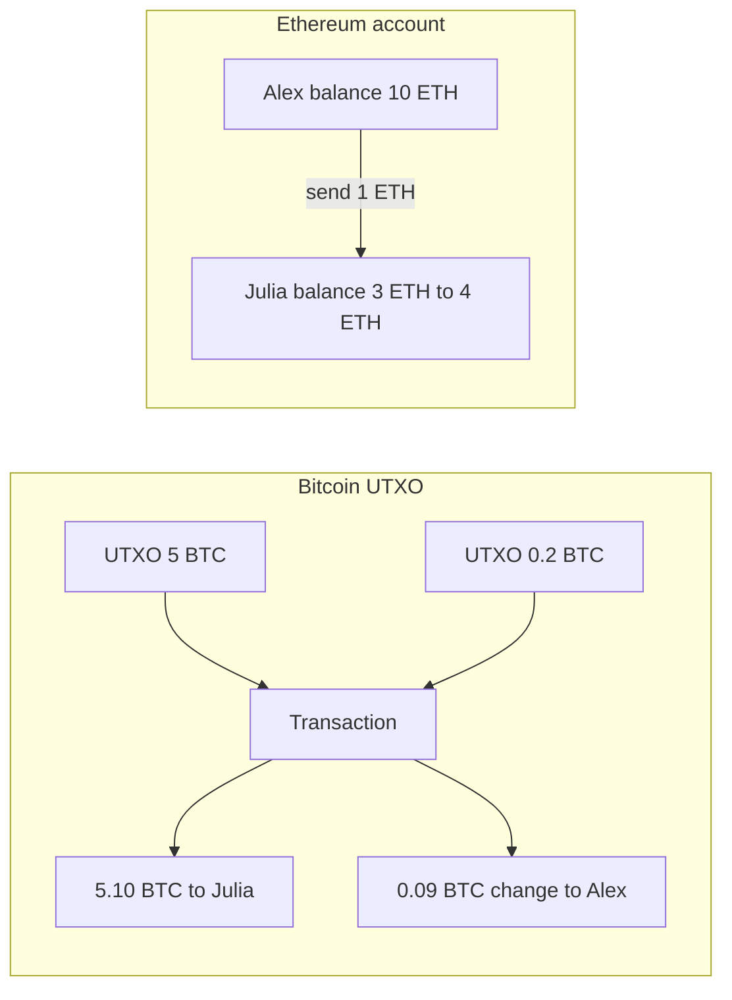

**In simple words:** Bitcoin tracks unspent coins like cash notes in a wallet. Ethereum keeps a balance for each account, like a bank passbook.

1. **Bitcoin UTXO model.** UTXO means Unspent Transaction Output: the result of a transaction that has not been used as an input yet. Your balance is the sum of the UTXOs you can unlock. <Cite id="class-bt-m5" loc="slide 96" /> <Cite id="class-bt-m5" loc="slide 97" />
2. **Spent whole.** UTXOs are indivisible; extra goes back to you as change, after the fee. **Example:** Alex pays Julia 5.10 BTC using 5 + 0.2 BTC; Julia gets 5.10, Alex gets 0.09 change, 0.01 is the fee. <Cite id="class-bt-m5" loc="slide 99" />
3. **Ethereum account model.** Each account has a balance and a nonce; a payment subtracts from one balance and adds to another. <Cite id="class-bt-m3a" loc="slide 44" /> <Cite id="wallets-utxo-double-spending-eth-accounts" />

| Point | UTXO (Bitcoin) | Account (Ethereum) |
|---|---|---|
| What is stored | Unspent outputs | Balance and nonce per account |
| A payment | Spends whole outputs, returns change | Subtracts and adds balances |
| Double spending | A UTXO can be spent once | Stopped by a nonce on each transaction |
| Smart contracts | Hard | Natural: contract accounts hold code and storage |
| Parallel checking | Easy | Harder |
| Privacy | Better (new address each time) | Reused address |

<Cite id="wallets-utxo-double-spending-gfg-utxo" />

**Extend in the exam (add these to reach 10 marks):**

- **Balance check.** Inputs = outputs + fee; the fee is the left-over for the miner. 
- **UTXO set.** Every full node keeps the set of unspent outputs. <Cite id="bitcoin-mb-ch06-transactions" />
- **Account types.** EOA and contract account. <Cite id="class-bt-m3a" loc="slide 42" />
- **Replay protection.** The nonce counts transactions sent so each is processed once and in order. <Cite id="class-bt-m3a" loc="slide 44" />

**Conclusion:** UTXO suits simple, checkable money; the account model suits programmable contracts. <Cite id="wallets-utxo-double-spending-learnmeabitcoin-utxo" />
