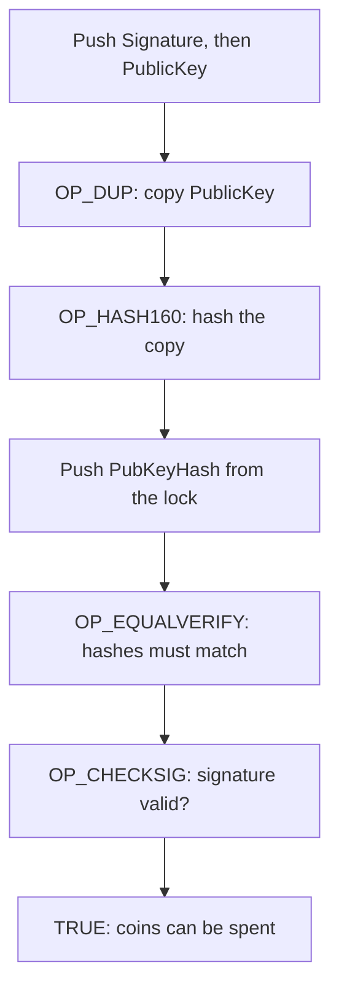

**In simple words:** Bitcoin Script is a tiny program inside a transaction. It is a lock on the coins, and the owner opens it with a signature and public key.

**Bitcoin Script:** a simple, stack-based language used to define the conditions for spending bitcoin. It is not Turing complete: it has no loops, so no script can use up the computing power of nodes. It is used almost only to lock and unlock bitcoin. <Cite id="class-bt-m2" loc="slide 142" />

**P2PKH (Pay-to-Public-Key-Hash):** the most common script. It locks bitcoin to the hash of a public key (the address) instead of the key itself. <Cite id="class-bt-m2" loc="slide 146" />

- **Locking script (scriptPubKey):** `OP_DUP OP_HASH160 <PubKeyHash> OP_EQUALVERIFY OP_CHECKSIG`
- **Unlocking script (scriptSig):** `<Signature> <PublicKey>` <Cite id="class-bt-m2" loc="slide 149" />

**Meaning of each step:** <Cite id="class-bt-m2" loc="slide 150" />

1. `OP_DUP` copies the public key (needed once for hashing, once for the signature).
2. `OP_HASH160` hashes it with SHA-256 then RIPEMD-160.
3. `<PubKeyHash>` is Bob's address stored in the lock.
4. `OP_EQUALVERIFY` checks the two hashes are equal.
5. `OP_CHECKSIG` checks the signature is valid for the public key.

**Example:** Alice sends 1 BTC to Bob's address. To spend it, Bob provides his signature and public key; the node hashes the key, matches Alice's stored hash and verifies the signature. <Cite id="class-bt-m2" loc="slide 147" />

| Step | Operation | Stack after (top on right) |
|---|---|---|
| 1 | Push Signature | Sig |
| 2 | Push PublicKey | Sig, PubKey |
| 3 | OP_DUP | Sig, PubKey, PubKey |
| 4 | OP_HASH160 | Sig, PubKey, Hash |
| 5 | Push PubKeyHash | Sig, PubKey, Hash, PubKeyHash |
| 6 | OP_EQUALVERIFY | Sig, PubKey |
| 7 | OP_CHECKSIG | TRUE |

**Extend in the exam (add these to reach 10 marks):**

- **Why hash the key.** The public key stays hidden until spending and the address is shorter. <Cite id="bitcoin-lmab-p2pkh" />
- **P2SH.** Locks to the hash of a script; used for multisig. <Cite id="class-bt-m2" loc="slide 151" />
- **Multisig.** Needs several signatures. <Cite id="class-bt-m2" loc="slide 144" />
- **Safety.** Simple script means fewer bugs and no infinite loops. <Cite id="class-bt-m2" loc="slide 143" />

**Conclusion:** P2PKH locks coins to a public-key hash and unlocks them with a signature and the public key. <Cite id="bitcoin-btcwiki-script" />
