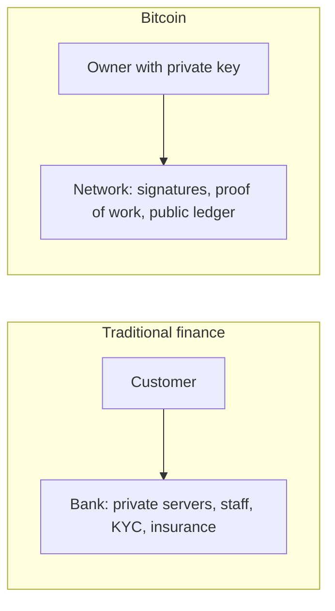

**In simple words:** a bank keeps your money safe by being a trusted guard. Bitcoin keeps it safe with maths and thousands of computers, but you must guard your own key.

**Bitcoin security features:**

1. **Keys and signatures.** Only the private key can sign a spend; the network checks with the public key. <Cite id="class-bt-m2" loc="slide 117" />
2. **Hash-linked blocks.** Changing an old block breaks all later blocks. <Cite id="class-bt-m1" loc="slide 105" />
3. **Proof of work.** An attacker needs more than 50% of mining power to rewrite history, which is "very difficult" but a theoretical risk. <Cite id="class-bt-m2" loc="slide 41" /> <Cite id="consensus-mining-btcwiki-majority" />
4. **Decentralization.** Nodes validate and keep the chain, so there is no single server to hack. <Cite id="class-bt-m2" loc="slide 122" />
5. **Public ledger.** Transactions are visible, hard to reverse and difficult to fake. <Cite id="class-bt-m2" loc="slide 109" />

| Point | Bitcoin | Traditional system |
|---|---|---|
| Trust | Code and network | Bank |
| Single point of failure | None | Central servers |
| Records | Public, hash-linked | Private |
| Reversal | Almost impossible | Chargeback possible |
| Identity | Pseudonymous | KYC verified |
| Lost access | Coins lost | Bank helps recover |
| Legal protection | Little | Regulation, insurance |
| Main threat | Key theft, scams | Data breach, insider fraud |

<Cite id="web-bt-sol-a-btcwiki-irrev" /> <Cite id="wallets-utxo-double-spending-btcwiki-weaknesses" />

**Extend in the exam (add these to reach 10 marks):**

- **Weak spots of Bitcoin.** Lost or stolen keys, exchange hacks, phishing and irreversible mistakes. <Cite id="web-bt-sol-a-btcorg-secure" />
- **Why 6 confirmations.** An attacker's chance of catching up falls sharply with each block. <Cite id="blockchain-fundamentals-nakamoto" loc="§11" />
- **Traditional strengths.** Fraud teams, refunds, deposit insurance and legal action.
- **Verdict.** Neither is simply more secure; they guard against different threats. <Cite id="bitcoin-wiki-bitcoin" />

**Conclusion:** Bitcoin has no single point of failure and is hard to forge, but the user alone carries the key risk.
