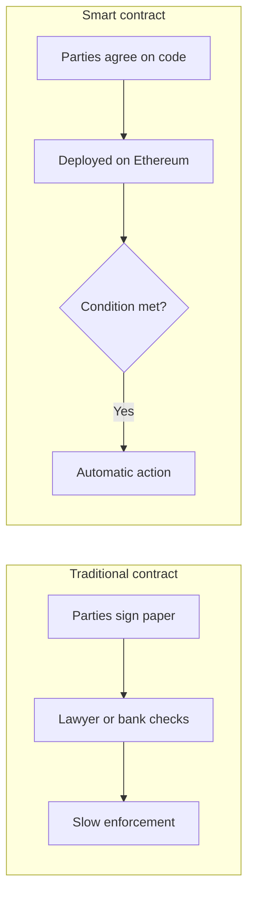

**In simple words:** a traditional contract needs people, papers and lawyers to enforce it. An Ethereum smart contract is code that enforces itself, like a vending machine.

**Definition:** an Ethereum smart contract is a program stored on the Ethereum blockchain that automatically executes an agreement when predefined conditions are met; unlike a traditional contract it does not always need a third party to enforce it. <Cite id="class-bt-m3a" loc="slide 47" />

**Advantages over traditional contracts:** <Cite id="class-bt-m3a" loc="slide 48" /> <Cite id="class-bt-m3a" loc="slide 49" />

1. **Automation.** Executes by itself when conditions are met, with less manual work.
2. **No intermediaries.** Removes or reduces banks, brokers and agents. **Example:** an insurance contract that pays out by itself.
3. **Lower cost.** Fewer middlemen and less paperwork.
4. **Transparency.** Code and transactions are on the blockchain and everyone can verify them.
5. **Security.** Cryptography makes unauthorised change difficult.
6. **Faster execution.** Days of verification become automatic execution.
7. **Accuracy.** Fixed code reduces human error.
8. **Trustless execution.** The blockchain and code enforce the rules, so parties need not fully trust each other.

| Point | Traditional contract | Ethereum smart contract |
|---|---|---|
| Enforcement | Courts, lawyers | Code |
| Middlemen | Many | None or few |
| Cost | High | Low (gas fee) |
| Speed | Days | Minutes |
| Records | Private papers | Public blockchain |
| Changing it | Both parties can amend | Cannot be changed once deployed |

<Cite id="smart-contracts-gfg-smart-contracts" />

**Extend in the exam (add these to reach 10 marks):**

- **Idea.** Proposed by Nick Szabo in 1994, like a vending machine. <Cite id="smart-contracts-szabo-1994" />
- **Limits.** Bugs cannot be fixed easily, outside data needs oracles and legal status is unclear. <Cite id="smart-contracts-eth-intro" />
- **Uses.** Crowdfunding, insurance, supply chain, tokens, DeFi. 
- **Language.** Solidity, run on the EVM. <Cite id="class-bt-m3a" loc="slide 9" />

**Conclusion:** smart contracts replace trust in people with trust in code, at lower cost and higher speed. <Cite id="smart-contracts-ibm-smart-contracts" />
