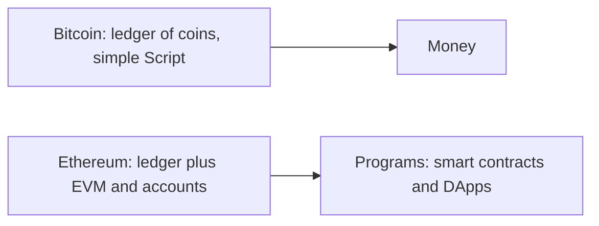

**In simple words:** Bitcoin is mainly digital money. Ethereum is a platform where programs (smart contracts) run, and it has its own money, ether.

**Functionality and use cases:** <Cite id="class-bt-m3a" loc="slide 51" />

- **Bitcoin use cases:** digital payments, store of value, investment, transfer of value without traditional intermediaries.
- **Ethereum use cases:** smart contracts, DApps, DeFi, NFTs, token creation, DAOs and blockchain games.

| Point | Bitcoin | Ethereum |
|---|---|---|
| Creator and year | Satoshi Nakamoto, 2009 | Vitalik Buterin and others, 2015 |
| Main purpose | Digital cash, store of value | Smart contracts and DApps |
| Coin | BTC | ETH |
| Consensus | Proof of Work | Proof of Stake since 2022 |
| Block time | About 10 minutes | About 12 seconds |
| Ledger model | UTXO | Account model |
| Scripting | Limited Script, no loops | Solidity on the EVM, Turing complete |
| Supply | Capped at 21 million | No fixed cap |
| Fees | Per byte of transaction | Gas |

<Cite id="class-bt-m3a" loc="slide 50" /> <Cite id="bitcoin-gfg-bitcoin-vs-ethereum" /> <Cite id="bitcoin-educative-bitcoin-vs-ethereum" />

**Similarities:** both are public, use hashes and digital signatures, and keep a copy of the ledger on many nodes.

**Extend in the exam (add these to reach 10 marks):**

- **Ethereum history.** Described in 2013, launched 2015; London upgrade (EIP-1559) in 2021; Merge to Proof of Stake in 2022. <Cite id="class-bt-m3a" loc="slide 3" />
- **Ethereum functions.** Accounts, gas, EVM, tokens (ERC-20, ERC-721). <Cite id="class-bt-m3a" loc="slide 5" />
- **Example.** Bitcoin to send money abroad without a bank; Ethereum to run a lending app or issue an NFT. 
- **Security trade-off.** Bitcoin keeps Script simple on purpose; Ethereum's flexibility brings contract bugs.

**Conclusion:** Bitcoin is secure, simple money; Ethereum is a flexible platform for any application. <Cite id="blockchain-fundamentals-nakamoto" /> <Cite id="ethereum-whitepaper" />
