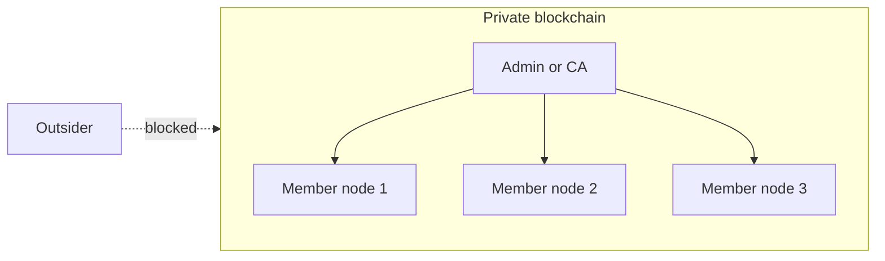

**In simple words:** A private blockchain is a shared ledger that only invited, known members can use. It is like a company's internal network: outsiders cannot enter. <Cite id="class-bt-m4" loc="slide 2" />

**Definition:** A private blockchain is a distributed ledger technology restricted to a specific group of participants, typically within a single organization or consortium. It works on permission: only authorized users can access and validate transactions. <Cite id="class-bt-m4" loc="slide 2" />

**Key features:**

1. **Permissioned access.** A member must be approved before joining. *Example:* only ABC Bank's branches can use the bank's ledger. <Cite id="class-bt-m4" loc="slide 3" />
2. **Centralized governance.** One body or consortium sets rules and manages permissions.
3. **Data privacy.** Only approved members see transaction details.
4. **Faster transactions.** Few participants take part in consensus, so confirmation is quick. <Cite id="class-bt-m4" loc="slide 4" />
5. **Customizable protocols.** The owner picks the consensus and rules.
6. **Low energy use.** No mining is needed (Raft, PBFT or PoA are used). <Cite id="class-bt-m4" loc="slide 5" />

**Advantages and disadvantages:**

| Advantages | Disadvantages |
|---|---|
| **Speed:** high transaction rate because the network is small | **Security:** few nodes, so manipulation is more likely |
| **Scalability:** the owner decides the network size | **Centralized:** trust must be placed in the owner, who may misuse it |
| **Privacy:** suits business confidentiality | **Count:** if few nodes go offline, the whole system is endangered |
| **Balanced:** only some users access transactions, so performance improves | Less open and less decentralized than a public chain |

<Cite id="class-bt-m1" loc="slide 59" /> <Cite id="class-bt-m1" loc="slide 60" />

**Extend in the exam (add these to reach 10 marks):**

- **Why it is needed.** Privacy, access control, faster transactions, organizational control, data compliance and lower cost. <Cite id="class-bt-m4" loc="slide 6" />
- **Real examples.** JPMorgan Quorum (banking), Walmart and IBM Food Trust (food tracing), R3 Corda (finance). <Cite id="class-bt-m4" loc="slide 9" />
- **Smart contracts.** A contract runs predefined rules, but only authorized participants can call it. <Cite id="class-bt-m4" loc="slide 16" />
- **Use cases.** Internal auditing, voting and asset management. <Cite id="class-bt-m1" loc="slide 61" />

**Conclusion:** A private blockchain gives speed, privacy and control, but it is less decentralized, so it fits businesses that already know each other. <Cite id="private-blockchain-gfg-private" />
