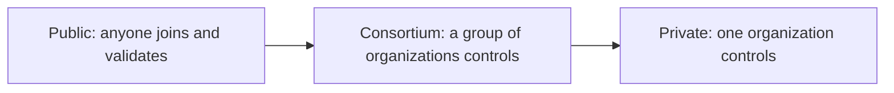

**In simple words:** A public blockchain is open to everyone, a private one belongs to a single organization, and a consortium one is run by a group of organizations together. <Cite id="blockchain-fundamentals-gfg-types" />

**The three types:**

1. **Public blockchain.** Anyone can join, read, write and validate. No one owns it. It is trustable, secure and decentralized, but slow and energy hungry (Proof of Work). *Examples:* Bitcoin, Ethereum. <Cite id="class-bt-m1" loc="slide 55" /> <Cite id="class-bt-m1" loc="slide 56" />
2. **Private blockchain.** One organization controls who joins and what each member may read or write. It is fast and private but centralized. *Example:* a bank's internal ledger. <Cite id="class-bt-m1" loc="slide 58" />
3. **Consortium blockchain.** Several organizations jointly manage the nodes that verify transactions. No single organization has complete control. It balances decentralization and control. *Examples:* R3 Corda, Hyperledger Fabric. <Cite id="class-bt-m4" loc="slide 10" /> <Cite id="class-bt-m4" loc="slide 12" />

**Comparison:**

| Point | Public | Private | Consortium |
|---|---|---|---|
| Access | Open to all | Invite only | Approved organizations |
| Control | Nobody | One organization | Group of organizations |
| Decentralization | Highest | Lowest | Partial |
| Speed | Slow | Fast | Fast |
| Privacy | Low | High | Medium to high |
| Consensus | PoW, PoS | Raft, PBFT, PoA | PBFT, Raft, IBFT |
| Energy and cost | High | Low | Low |
| Examples | Bitcoin, Ethereum | Internal bank ledger | Corda, Fabric, TradeLens |

<Cite id="private-blockchain-gfg-pubpriv" /> <Cite id="private-blockchain-gfg-consortium" />

**Extend in the exam (add these to reach 10 marks):**

- **Trust model.** Public: trust the code. Private: trust the owner. Consortium: trust the group.
- **Why consortium exists.** Several organizations need shared control, secure data sharing, faster transactions and one synchronized record. <Cite id="class-bt-m4" loc="slide 13" /> <Cite id="class-bt-m4" loc="slide 14" />
- **Disadvantages.** Public: slow, energy use, governments find acceptance hard. Private: centralized, few nodes. Consortium: members must agree on rules. <Cite id="class-bt-m1" loc="slide 56" />
- **Real examples.** Private: Quorum, Walmart. Consortium: TradeLens (Maersk and IBM), which was shut down in 2023. <Cite id="class-bt-m4" loc="slide 15" />
- **Choosing.** Unknown, untrusted users: public. One owner: private. Many known organizations: consortium. <Cite id="blockchain-fundamentals-nist-8202" />

**Conclusion:** Choose public for openness, private for control and speed, and consortium for shared control between businesses.
