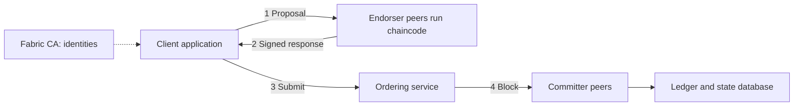

**In simple words:** Hyperledger Fabric is a blockchain for businesses. Only known organizations join, and its smart contracts are called chaincode. <Cite id="class-bt-m4" loc="slide 41" />

**Definition:** Hyperledger Fabric is designed for enterprise-level applications. It has a modular architecture, a permissioned network and smart contracts called chaincode. <Cite id="class-bt-m4" loc="slide 41" /> <Cite id="hyperledger-fabric-whatis" />

**Architecture (the parts):**

1. **Members and Certificate Authority (CA).** Each organization is identified by a Fabric CA certificate. <Cite id="class-bt-m4" loc="slide 43" />
2. **Peers.** Each member runs authorized peers. An endorser simulates a transaction, a committer validates blocks and writes them to the ledger, and the consenter (orderer) orders transactions. <Cite id="class-bt-m4" loc="slide 25" />
3. **Client application.** Written with an SDK; it sends the transaction proposal. <Cite id="class-bt-m4" loc="slide 44" />
4. **Chaincode.** The smart contract layer that holds business rules. <Cite id="class-bt-m4" loc="slide 53" />
5. **Ledger and state database.** LevelDB (default) or CouchDB. <Cite id="class-bt-m4" loc="slide 57" />
6. **Identity and policy services.** Identity answers "who are you?"; endorsement policy says who must approve. <Cite id="class-bt-m4" loc="slide 60" /> <Cite id="class-bt-m4" loc="slide 62" />

**Workflow:** proposal, endorsement, submission to the ordering service, then ledger update. <Cite id="class-bt-m4" loc="slide 46" /> <Cite id="class-bt-m4" loc="slide 48" />

**Applications:** finance, supply chain and healthcare. *Example:* a supply-chain network where manufacturers, distributors, retailers and logistics companies share transaction data securely. <Cite id="class-bt-m4" loc="slide 37" />

**Extend in the exam (add these to reach 10 marks):**

- **Channels.** A private sub-network with its own ledger, so only its members see the data. <Cite id="hyperledger-fabric-gfg-fabric" />
- **Advantages.** Security, privacy, scalability, pluggable consensus, and no cryptocurrency needed. <Cite id="class-bt-m4" loc="slide 41" />
- **Real use.** IBM Food Trust (Walmart traced mangoes in about 2.2 seconds instead of nearly 7 days). <Cite id="hyperledger-fabric-ibm-fabric" />
- **Execute-order-validate.** Endorse first, order second, validate last; the orderer never runs chaincode. <Cite id="hyperledger-fabric-androulaki-2018" />
- **Comparison.** Fabric is permissioned and needs no coin; Bitcoin and Ethereum are public and need a coin.

**Conclusion:** Fabric separates endorsing, ordering and validating, which gives private, scalable enterprise applications.
