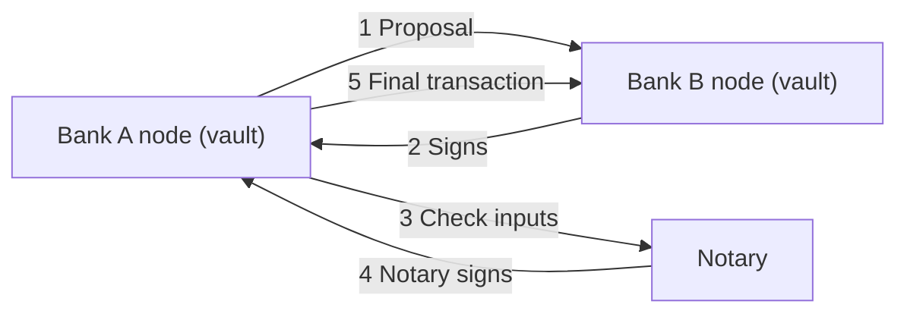

**In simple words:** Bitcoin and Ethereum send every transaction to every node. Corda sends a transaction only to the parties in the deal, so it keeps business data private. <Cite id="class-bt-m4" loc="slide 87" />

**Corda in one line:** a permissioned distributed ledger platform for businesses and regulated financial institutions, developed by R3, with strict data privacy and verified legal identities. <Cite id="class-bt-m4" loc="slide 86" />

**How Corda differs (three dimensions):**

1. **Privacy.** Data is shared only with the parties involved and others with a legitimate need to know, such as a regulator. <Cite id="class-bt-m4" loc="slide 88" />
2. **Scalability.** Transactions flow only between counterparties, so the network does not slow down as more institutions join. <Cite id="class-bt-m4" loc="slide 89" />
3. **Enterprise compliance.** Every participant has a verified identity, and smart contracts are linked to legal prose. <Cite id="class-bt-m4" loc="slide 89" />

| Point | Bitcoin | Ethereum | Corda |
|---|---|---|---|
| Access | Public | Public | Permissioned |
| Who sees a transaction | Everyone | Everyone | Only the parties involved |
| Consensus | Proof of Work | Proof of Stake | Notary checks uniqueness |
| Contracts | Limited script | Solidity | Kotlin or Java, tied to legal text |
| Identity | Pseudonymous | Pseudonymous | Verified legal entity |
| Aim | Digital cash | General dApps | Finance and legal agreements |

<Cite id="class-bt-m4" loc="slide 90" /> <Cite id="bitcoin-gfg-bitcoin-vs-ethereum" />

**Role in enterprise applications:** Corda is used in financial services (syndicated loans, bonds), trade finance, insurance, healthcare and supply chain. <Cite id="class-bt-m4" loc="slide 109" /> <Cite id="class-bt-m4" loc="slide 110" />

**Extend in the exam (add these to reach 10 marks):**

- **Components.** Nodes with a vault, notary service, states, contracts and flows. <Cite id="class-bt-m4" loc="slide 92" />
- **State model.** A state is never edited; it is consumed and replaced (like UTXO). <Cite id="class-bt-m4" loc="slide 97" />
- **Notary.** Guarantees uniqueness, which prevents double spending without global visibility. <Cite id="class-bt-m4" loc="slide 95" />
- **Network map and identity.** A directory of nodes and X.509 certificates. <Cite id="class-bt-m4" loc="slide 101" />
- **Limits.** Smaller community than Ethereum and not meant for public coins. <Cite id="corda-ripple-quorum-corda-tech-wp" />

**Conclusion:** Corda trades global broadcast for privacy, legal fit and scale, which is what regulated enterprises need. <Cite id="corda-ripple-quorum-xoriant-corda" />
