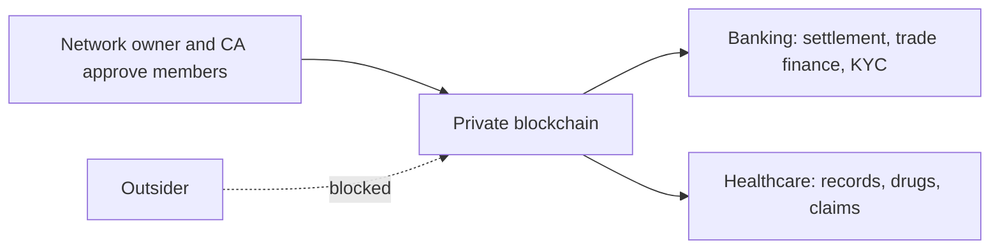

**In simple words:** Banks and hospitals handle private data but need many parties to share one record. A private blockchain lets only approved members share it. <Cite id="class-bt-m4" loc="slide 8" />

**Why private?** It gives privacy, access control, fast transactions, organizational control, data compliance and lower cost. <Cite id="class-bt-m4" loc="slide 6" />

**Banking use cases:**

1. **Transfers and settlement.** Branch A sends Rs 1 lakh to Branch B; only authorized bank nodes can submit, validate and read it. <Cite id="class-bt-m4" loc="slide 7" />
2. **Interbank transactions.** JPMorgan's Quorum is used for banking and financial transactions where data needs restricted access. <Cite id="class-bt-m4" loc="slide 9" />
3. **Trade finance, insurance and loans.** R3 Corda shares a deal only with the relevant parties. <Cite id="class-bt-m4" loc="slide 109" />
4. **KYC and audit.** One verified customer record and a time-stamped history are shared among banks.

**Healthcare use cases:**

1. **Electronic health records.** Patient records are stored and shared securely. <Cite id="class-bt-m6" loc="slide 11" />
2. **Controlled sharing.** Authorized doctors, labs and patients see only what they need. <Cite id="class-bt-m6" loc="slide 12" />
3. **Drug supply chain.** Medicines are tracked from maker to patient to spot counterfeits.
4. **Insurance claims.** Records reduce duplicate or fraudulent claims. <Cite id="class-bt-m6" loc="slide 13" />

| Platform | Industry use | Why private |
|---|---|---|
| Quorum | Banking | Restricted financial data |
| Corda | Banking, insurance | Only relevant parties see a deal |
| Hyperledger Fabric | Healthcare, supply chain | Permissioned network of organizations |

<Cite id="class-bt-m4" loc="slide 15" />

**Extend in the exam (add these to reach 10 marks):**

- **Smart contracts.** An insurance payout or payment can run automatically once the rule is met. <Cite id="class-bt-m4" loc="slide 16" />
- **Hash on chain, data off chain.** For health data, keep the record in a secure database and store only its hash on the chain.
- **Clinical trials.** Trial records are kept transparent and tamper-resistant. <Cite id="class-bt-m6" loc="slide 13" />
- **Limits.** Less decentralized, trust in the owner, and wrong data entered stays wrong. <Cite id="web-bt-sol-b-gfg-usecases" />

**Conclusion:** Private blockchains give banks and hospitals a shared, tamper-proof record without exposing sensitive data. <Cite id="blockchain-fundamentals-ibm-blockchain" />
