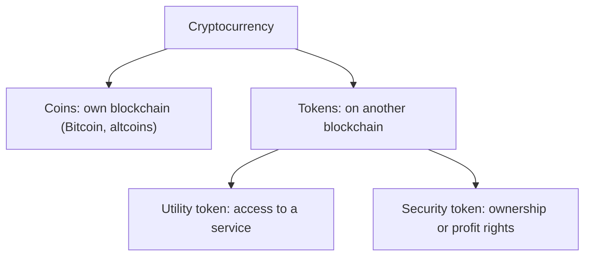

**In simple words:** An altcoin is a coin with its own blockchain (other than Bitcoin). A token lives on someone else's blockchain. A utility token gives use of a service; a security token gives ownership or a share of profit. <Cite id="cryptocurrencies-tokens-gfg-coins-tokens" />

**The three terms:**

1. **Altcoins.** Every cryptocurrency other than Bitcoin that runs on its own blockchain. They try to improve on Bitcoin (speed, cost, features). *Examples:* Ether (the native coin of Ethereum), Litecoin (nearly identical to Bitcoin, built to make payment easier), Solana (speed and low cost). <Cite id="class-bt-m5" loc="slide 9" /> <Cite id="class-bt-m5" loc="slide 10" />
2. **Utility tokens.** Tokens built on an existing chain (often ERC-20) that give access to a product or service, or pay for it. They are not a share in the company. *Examples:* Basic Attention Token (advertising), Chainlink's LINK (oracle service). <Cite id="web-bt-sol-b-gfg-crypto-types" />
3. **Security tokens.** Digital tokens that represent securities or financial rights (ownership, profit sharing, assets) and follow securities laws. They are sold through a Security Token Offering (STO). *Example:* a token that represents a share in a building. <Cite id="class-bt-m5" loc="slide 44" /> <Cite id="class-bt-m5" loc="slide 45" />

| Point | Altcoin | Utility token | Security token |
|---|---|---|---|
| Own blockchain | Yes | No | No |
| Gives | Payment, fees, features | Access to a service | Share, profit or asset rights |
| Law | Light | Light to uncertain | Strict securities law |
| Raised by | Mining or sale | ICO or token sale | STO |
| Example | Litecoin, Ether | BAT, LINK | Real-estate or share token |

<Cite id="cryptocurrencies-tokens-gfg-security-token" /> <Cite id="web-bt-2-wiki-security-token" />

**Extend in the exam (add these to reach 10 marks):**

- **Bitcoin versus altcoin.** Bitcoin (2009) is the most accepted coin; altcoins came after it. <Cite id="class-bt-m5" loc="slide 9" />
- **Why STO exists.** ICOs had fraud and weak regulation, so regulators treated many tokens as securities. <Cite id="class-bt-m5" loc="slide 44" />
- **Token standard.** ERC-20 tokens follow common functions, so wallets and exchanges support them. <Cite id="class-bt-m5" loc="slide 20" />
- **Other kinds.** Governance tokens give votes in a protocol; stablecoins are pegged to the dollar. <Cite id="class-bt-m5" loc="slide 13" />
- **Risk.** Utility tokens may give no legal rights; security tokens create legal duties for the issuer. <Cite id="class-bt-m5" loc="slide 45" />

**Conclusion:** Altcoins are money-like coins, utility tokens give use, and security tokens give ownership under law. <Cite id="cryptocurrencies-tokens-wiki-crypto" />
