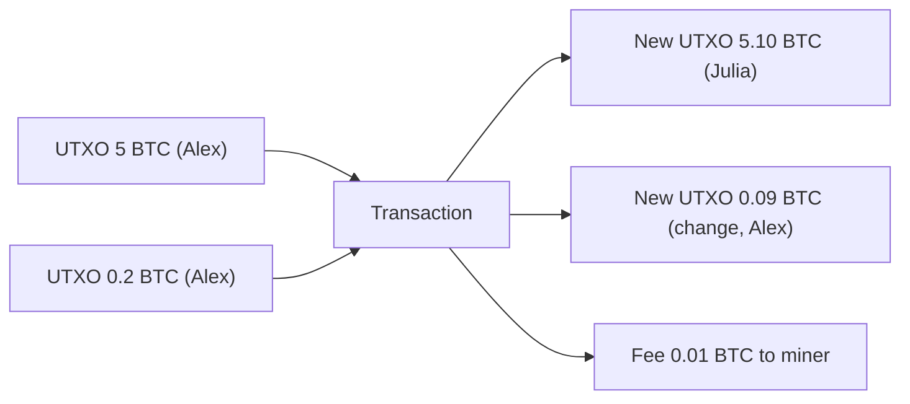

**In simple words:** Bitcoin does not keep a balance for you. It keeps unspent pieces of earlier payments, like cash notes. Your balance is the total of the notes your keys can spend. <Cite id="wallets-utxo-double-spending-learnmeabitcoin-utxo" />

**Definition:** UTXO stands for Unspent Transaction Output. A UTXO is a record of unspent cryptocurrency that remains after a transaction, like the change you get after a cash purchase. <Cite id="class-bt-m5" loc="slide 96" /> <Cite id="class-bt-m5" loc="slide 97" />

**How it works:**

1. **Inputs.** References to earlier UTXOs being spent, each with a signature that proves ownership. <Cite id="class-bt-m5" loc="slide 102" />
2. **Outputs.** New UTXOs, each with an amount and a destination address.
3. **Whole spending.** A UTXO cannot be split, so extra value comes back to you as **change**.
4. **Fee.** Inputs minus outputs is the miner's fee.
5. **Balance.** Your wallet balance is the sum of the UTXOs of your addresses. <Cite id="class-bt-m5" loc="slide 103" />

*Example:* Alex sends 5.10 BTC to Julia. The wallet picks UTXOs of 5 BTC and 0.2 BTC (5.20 total). Outputs: 5.10 to Julia, 0.09 back to Alex as change. The 0.01 left is the fee. <Cite id="class-bt-m5" loc="slide 99" />

**UTXO model versus account-based model:**

| Point | UTXO (Bitcoin) | Account-based (Ethereum) |
|---|---|---|
| What is stored | Unspent outputs | A balance per account |
| A payment | Spends whole outputs, returns change | Subtracts from one balance and adds to another |
| Double spending | A UTXO can be spent once | A nonce on each transaction orders them |
| Parallel checking | Easy | Harder |
| Smart contracts | Hard to program | Natural |
| Privacy | Better (new address each time) | Weaker (one address reused) |

<Cite id="wallets-utxo-double-spending-eth-accounts" />

**Extend in the exam (add these to reach 10 marks):**

- **Cash analogy.** A 100 bill for a 30 purchase: you give the whole bill and get 70 change. <Cite id="class-bt-m5" loc="slide 100" />
- **UTXO set.** Every full node keeps the set of all unspent outputs.
- **Double-spend defence.** Each UTXO is spent once; nodes check it is still unspent. <Cite id="class-bt-m5" loc="slide 113" />
- **Consolidation and CoinJoin.** Wallets merge small UTXOs to save fees and may mix UTXOs for privacy. <Cite id="class-bt-m5" loc="slide 104" />
- **Limits.** Harder to program; many small UTXOs make big, costly transactions. <Cite id="bitcoin-mb-ch06-transactions" />

**Conclusion:** Bitcoin tracks ownership as spendable outputs that are consumed and recreated, while Ethereum tracks account balances.
