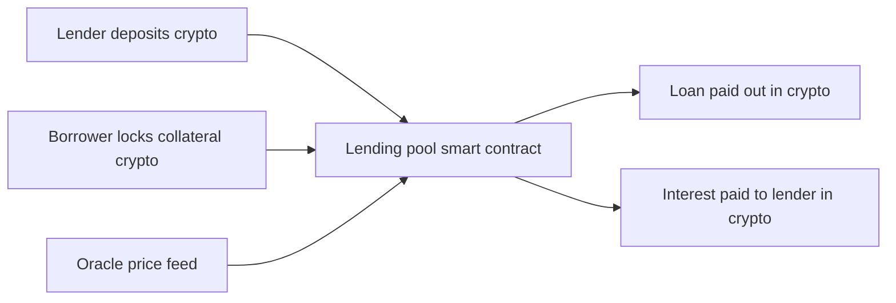

**In simple words:** DeFi (decentralized finance) offers bank-like services on a blockchain without a bank. Cryptocurrencies are the money that these services use. <Cite id="class-bt-m5" loc="slide 46" />

**Definition:** DeFi is an umbrella term for financial services on public blockchains, mainly Ethereum. You can earn interest, borrow, lend, buy insurance, trade derivatives and trade assets, faster and without paperwork or a third party. <Cite id="class-bt-m5" loc="slide 46" />

**Role of cryptocurrencies in DeFi:**

1. **Medium of exchange and settlement.** Coins like ETH and tokens move value directly between users. <Cite id="class-bt-m5" loc="slide 12" />
2. **Collateral.** Cryptocurrencies back DeFi loans and liquidity pools. <Cite id="class-bt-m5" loc="slide 13" />
3. **Gas fees.** ETH pays for running the smart contracts. <Cite id="class-bt-m5" loc="slide 12" />
4. **Stablecoins.** Dollar-pegged coins give a steady unit for lending and trading. <Cite id="cryptocurrencies-tokens-wiki-stablecoin" />
5. **Governance tokens.** Holders vote on protocol changes. <Cite id="class-bt-m5" loc="slide 13" />
6. **Rewards.** Interest and rewards are paid in tokens (lending, staking).

**What users do:** lending, instant loans (including flash loans), peer-to-peer trading, saving and derivatives. <Cite id="class-bt-m5" loc="slide 48" /> <Cite id="class-bt-m5" loc="slide 49" />

**Benefits and downsides:**

| Benefits | Downsides |
|---|---|
| Open: no account needed, just a wallet | Fluctuating Ethereum fees make active trading costly |
| Pseudonymous | High volatility |
| Flexible and fast | User keeps own tax records |
| Transparent | Contract bugs and hacks |

<Cite id="class-bt-m5" loc="slide 50" /> <Cite id="class-bt-m5" loc="slide 51" />

**Extend in the exam (add these to reach 10 marks):**

- **Layers.** Settlement (Ethereum), asset (ETH and tokens), protocol (exchange, lending), application, aggregation. <Cite id="blockchain-applications-ethereum-org-defi" />
- **Oracles.** Bring outside prices to contracts. <Cite id="smart-contracts-eth-oracles" />
- **Composability.** One contract calls another, like money Lego. <Cite id="smart-contracts-eth-defi" />
- **Compare with banks.** Banks: account, working hours, private records. DeFi: wallet, 24x7, public code.

**Conclusion:** Cryptocurrencies are the money, collateral and reward of DeFi, and smart contracts replace the middleman. <Cite id="smart-contracts-wiki-defi" />
