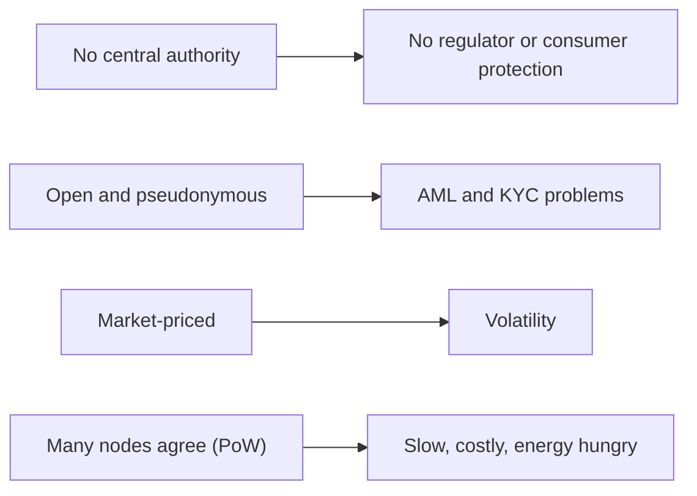

**In simple words:** Banks and markets work under laws and give customers protection. Cryptocurrencies have no central authority, so fitting them into this system is hard. <Cite id="class-bt-m5" loc="slide 2" />

**Challenges:**

1. **Volatility.** Prices swing quickly, so coins are hard to use for prices, salaries or loans. *Example:* a loan in a coin can grow in rupee value overnight. <Cite id="class-bt-m5" loc="slide 40" />
2. **Regulatory uncertainty.** Rules, taxes and legal status differ between countries; some restrict crypto. <Cite id="class-bt-m5" loc="slide 41" /> <Cite id="web-bt-sol-b-wiki-regulation-crypto" />
3. **Security and fraud.** Fake projects, phishing, fake websites and hacks of wallets and exchanges. <Cite id="class-bt-m5" loc="slide 81" />
4. **Scalability and fees.** Networks handle few transactions per second and fees change with demand. <Cite id="class-bt-m5" loc="slide 51" /> <Cite id="web-bt-1-eth-scaling" />
5. **Energy use.** Proof of Work uses much electricity. <Cite id="blockchain-fundamentals-ccaf-cbeci" />
6. **No consumer protection.** Transactions cannot be reversed and a lost key means lost money.
7. **Illegal use and AML/KYC.** Pseudonymous transfers make anti-money-laundering checks hard. <Cite id="class-bt-m5" loc="slide 41" />

| Challenge | Common response |
|---|---|
| Volatility | Stablecoins |
| Regulation | Licensing and clear rules |
| Security | Cold wallets, audits |
| Scalability, energy | Proof of Stake, layer 2 |
| Illegal use | KYC at exchanges |

<Cite id="cryptocurrencies-tokens-wiki-stablecoin" />

**Extend in the exam (add these to reach 10 marks):**

- **Token-sale problems.** Weak due diligence, scams, and founders selling tokens early. <Cite id="class-bt-m5" loc="slide 40" /> <Cite id="class-bt-m5" loc="slide 41" />
- **DeFi problems.** Changing fees, high volatility, and tax records kept by the user. <Cite id="class-bt-m5" loc="slide 51" />
- **Wallet risks.** Hot wallets face online attacks and risky smart-contract approvals. <Cite id="class-bt-m5" loc="slide 82" />
- **CBDC.** Central bank digital money (such as the e-rupee) is a regulated digital alternative. <Cite id="cryptocurrencies-tokens-wiki-crypto" />
- **Global view.** Regulators study global stablecoins closely. <Cite id="web-bt-sol-b-fsb-crypto" />

**Conclusion:** Crypto can enter mainstream finance only when volatility, regulation, security and scalability are handled.
