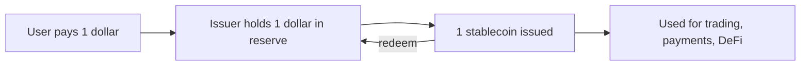

**In simple words:** A stablecoin is a cryptocurrency made to hold a steady price, usually one US dollar, so it is useful for payments. Bitcoin's price moves freely. <Cite id="class-bt-m5" loc="slide 10" />

**Definition:** Stablecoins are the class of cryptocurrencies whose values are designed to stay stable relative to real-world assets like the U.S. dollar. <Cite id="class-bt-m5" loc="slide 10" />

**Types (how the price is kept stable):**

1. **Fiat-backed.** One coin is backed by one dollar in a bank. *Examples:* USDT, USDC. <Cite id="web-bt-sol-b-gfg-stablecoins" />
2. **Crypto-backed.** Users lock more crypto than the coin value in a smart contract. *Example:* DAI.
3. **Commodity-backed.** Each coin stands for gold or similar. *Example:* DGX.
4. **Algorithmic.** Code adjusts the supply to hold the price; the riskiest type (TerraUSD failed in 2022). <Cite id="cryptocurrencies-tokens-wiki-stablecoin" />

**Difference from traditional cryptocurrencies:**

| Point | Bitcoin or Ether | Stablecoin |
|---|---|---|
| Price | Moves freely | Pegged to an asset |
| Backing | None | Dollars, crypto, gold or algorithm |
| Volatility | High | Low |
| Main use | Investment, store of value, fees | Payments, trading pair, DeFi |
| Issuer | None | Usually a company or protocol |
| Main risk | Price swings | Reserve, issuer and de-peg risk |

<Cite id="web-bt-sol-b-wiki-tether" />

**Extend in the exam (add these to reach 10 marks):**

- **Why needed.** Volatile coins are poor for prices, salaries and loans. <Cite id="web-bt-sol-b-gfg-stablecoins" />
- **Token form.** Most are ERC-20 tokens; Circle issues a dollar-valued token this way. <Cite id="class-bt-m5" loc="slide 21" /> <Cite id="cryptocurrencies-tokens-eth-erc20" />
- **Uses.** Cross-border payments, DeFi lending, and a safe place to park value.
- **De-pegging.** The price may fall below one dollar if people lose trust in the reserve.
- **Regulation.** Authorities watch global stablecoins closely. <Cite id="web-bt-sol-b-fsb-crypto" />

**Conclusion:** Stablecoins keep crypto's speed but a steady price; their safety depends on the backing and the issuer.
