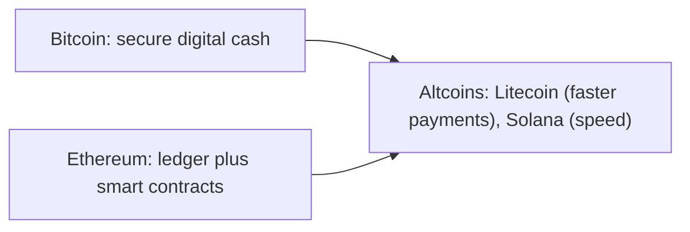

**In simple words:** Bitcoin is digital cash, Ethereum is a platform that runs programs, and altcoins are the other coins that improve or copy parts of these two. <Cite id="bitcoin-gfg-bitcoin-vs-ethereum" />

| Point | Bitcoin | Ethereum | Other altcoins |
|---|---|---|---|
| Created | 2009, Satoshi Nakamoto | 2015, Vitalik Buterin and others | After Bitcoin |
| Purpose | Digital payments, store of value | Smart contracts, dApps, DeFi, NFTs | Speed, low cost or special features |
| Coin | BTC | ETH (smallest unit Wei) | Litecoin, Solana, XRP |
| Consensus | Proof of Work | Proof of Stake since 2022 | Varies |
| Block time | About 10 minutes | About 12 seconds | Varies |
| Ledger model | UTXO | Account balances | Varies |
| Supply | 21 million cap | No fixed cap | Varies |

<Cite id="class-bt-m5" loc="slide 9" /> <Cite id="class-bt-m5" loc="slide 10" /> <Cite id="class-bt-m3a" loc="slide 51" /> <Cite id="bitcoin-educative-bitcoin-vs-ethereum" />

**Use cases:** Bitcoin: digital payments, store of value, investment, value transfer without intermediaries. Ethereum: smart contracts, dApps, DeFi, NFTs, token creation, DAOs and games. <Cite id="class-bt-m3a" loc="slide 51" />

**Altcoins in brief:** Litecoin is nearly identical to Bitcoin in technical terms and made for easier payment; Solana focuses on speed and cost-effectiveness. <Cite id="class-bt-m5" loc="slide 10" />

**Note:** Ethereum's 2022 Merge moved it from Proof of Work to Proof of Stake and cut its energy use by about 99.95 percent. (The class slide writes "Proof-of-State"; the correct term is Proof of Stake.) <Cite id="class-bt-m3a" loc="slide 4" />

**Conclusion:** Bitcoin is secure money, Ethereum is a programmable platform, and altcoins add variety. <Cite id="cryptocurrencies-tokens-gfg-coins-tokens" />
