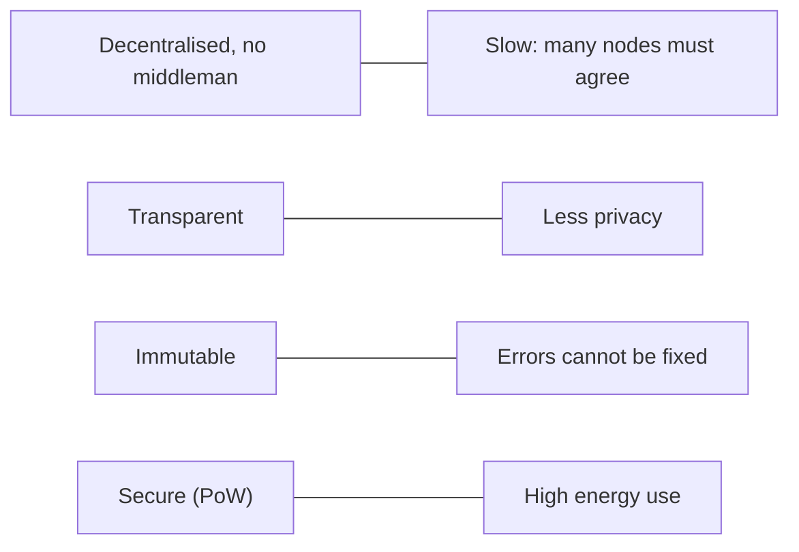

**In simple words:** Blockchain keeps one shared record that is hard to change, so it brings trust and transparency. The same design makes it slow, heavy and hard to correct. <Cite id="blockchain-fundamentals-ibm-blockchain" />

**Benefits in real applications:**

1. **Decentralization.** No single party controls the data; there is no single point of failure. <Cite id="class-bt-m1" loc="slide 4" /> <Cite id="class-bt-m1" loc="slide 5" />
2. **Transparency.** Authorized participants see the same record, which reduces information gaps. <Cite id="class-bt-m6" loc="slide 25" />
3. **Immutability and security.** Each block holds the previous block's hash, so changing old data breaks the chain and prevents tampering and fraud. <Cite id="class-bt-m1" loc="slide 105" />
4. **Traceability.** Every step of a product is recorded, for example in supply chains and drug tracking. <Cite id="class-bt-m6" loc="slide 26" />
5. **Lower cost and faster work.** Fewer intermediaries, less paperwork and automatic smart-contract payments. <Cite id="class-bt-m6" loc="slide 18" />

**Limitations:**

1. **Scalability.** Every node repeats the work, so transactions per second are low. <Cite id="web-bt-1-eth-scaling" />
2. **Energy use.** Proof of Work uses much electricity. <Cite id="class-bt-m1" loc="slide 56" /> <Cite id="blockchain-fundamentals-ccaf-cbeci" />
3. **Privacy versus transparency.** Public ledgers show all transactions.
4. **Immutability cuts both ways.** Errors and bugs cannot be undone, and a lost key means lost funds.
5. **Regulation and acceptance.** Governments find acceptance hard without a central authority. <Cite id="class-bt-m1" loc="slide 56" />
6. **Cost, skills and integration** with old systems.

| Real-world application | Benefit | Limitation |
|---|---|---|
| Supply chain | Traceability, fast recall | All partners must join |
| Healthcare | Secure records | Privacy laws |
| Real estate | Less fraud and paperwork | Land laws must accept it |
| Banking | Fast transfers, fraud reduction | Scale and regulation |

<Cite id="class-bt-m1" loc="slide 6" /> <Cite id="class-bt-m1" loc="slide 7" /> <Cite id="class-bt-m1" loc="slide 8" />

**Extend in the exam (add these to reach 10 marks):**

- **Garbage in, garbage out.** Blockchain shows data was not changed, not that it was true when entered; sensors and audits help.
- **Interoperability.** Chains cannot easily talk to each other or old systems.
- **Fixes.** Proof of Stake and layer 2 for speed and energy, private channels for privacy, audits for contract bugs. <Cite id="blockchain-fundamentals-gfg-advantages" />
- **Right tool.** Use blockchain where trust among many parties matters more than raw speed. <Cite id="blockchain-fundamentals-nist-8202" />

**Conclusion:** Blockchain fits applications that need trust, transparency and traceability, but it is not the right tool for every problem.
