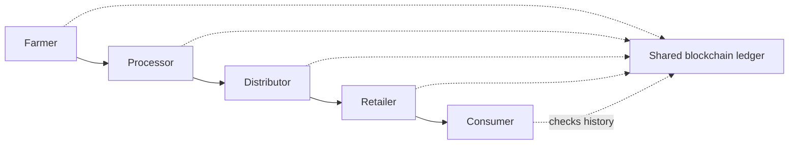

**In simple words:** Blockchain gives supply chains a shared record of a product's journey, gives people an identity they control, and gives finance faster, cheaper transfers. <Cite id="blockchain-applications-gfg-supply-revolution" />

**1. Supply chain management.** Blockchain provides a shared, tamper-resistant record of a product from origin to the final consumer. <Cite id="class-bt-m6" loc="slide 23" />

1. **Traceability and origin.** Every stage from raw material to customer is recorded.
2. **Counterfeit detection.** Records show whether a product came through an authorized chain.
3. **Smart contracts.** Payment is released when delivery or quality conditions are met. <Cite id="class-bt-m6" loc="slide 24" />
4. **Faster recalls.** The source of a defective item is found quickly. <Cite id="class-bt-m6" loc="slide 25" />

*Example:* Farmer, Processor, Warehouse, Distributor, Retailer, Consumer; at every stage the relevant information is saved. Walmart traced mangoes in about 2.2 seconds instead of nearly 7 days. <Cite id="hyperledger-fabric-ibm-fabric" />

**2. Digital identity systems.** A digital identity is the proof of who a person is online. In a self-sovereign model the person holds their own credentials and shows only what is needed. Hyperledger Indy is built for this: it supports **verifiable credentials** and gives people greater control of their identity. *Example:* a university issues a certificate that the student later shows to an employer. <Cite id="class-bt-m4" loc="slide 40" /> <Cite id="web-bt-sol-b-wiki-ssi" /> <Cite id="web-bt-sol-b-w3c-vc" />

**3. Financial services.** Blockchain gives faster money transfers, cross-border payments and fraud reduction. <Cite id="class-bt-m1" loc="slide 6" /> *Examples:* Ripple moves cross-border payments in seconds; Quorum and Corda serve banks with privacy. <Cite id="class-bt-m4" loc="slide 9" /> <Cite id="corda-ripple-quorum-gfg-ripple" />

| Area | Problem today | Role of blockchain |
|---|---|---|
| Supply chain | Separate records, fakes, slow recalls | Shared record, traceability |
| Digital identity | Many logins, central databases, fake documents | User-held verifiable credentials |
| Financial services | Slow, costly transfers and reconciliation | Fast settlement, shared ledger, smart contracts |

**Extend in the exam (add these to reach 10 marks):**

- **Supply chain advantages.** End-to-end traceability, transparency, faster recalls, supplier coordination, customer trust. <Cite id="class-bt-m6" loc="slide 26" />
- **Identity benefit.** Less paperwork, less identity fraud, and the user decides who sees what.
- **Finance extras.** Smart-contract settlement, trade finance and KYC sharing.
- **Limits.** Wrong data entered stays wrong; all partners must join; privacy laws apply. <Cite id="web-bt-2-wiki-scm" />

**Conclusion:** Blockchain makes supply chains traceable, identities user-controlled and financial services faster.
