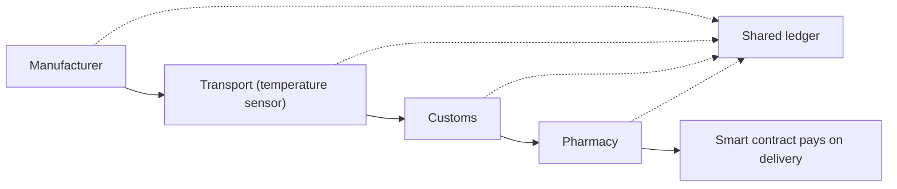

**In simple words:** Logistics moves goods from sender to customer through many companies. Blockchain gives all of them one trusted record of where the goods are and what was done. <Cite id="class-bt-m6" loc="slide 19" />

**Case study: shipping logistics (Maersk and IBM TradeLens).**

**Problem.** Shipping needs shippers, ports, customs and carriers, each with its own paper documents and systems. Information is late, documents get lost and fraud is possible. <Cite id="class-bt-m4" loc="slide 9" />

**Solution.** TradeLens was a shared platform from Maersk and IBM where authorized parties saw one record of a shipment. It was meant for controlled sharing of data among shipping companies, ports and customs. <Cite id="class-bt-m4" loc="slide 15" />

**How blockchain helps logistics:**

1. **Shipment tracking.** Each stage of transport is recorded. <Cite id="class-bt-m6" loc="slide 19" />
2. **Real-time visibility.** Authorized parties see status reliably.
3. **Proof of delivery.** When and where goods were delivered is recorded.
4. **Smart contracts.** Payment is triggered automatically after delivery conditions are met. <Cite id="class-bt-m6" loc="slide 20" />
5. **Document management.** Invoices and delivery records are digital.
6. **Customs and border management.** Trusted records are shared among the parties.
7. **Condition monitoring.** IoT sensors record temperature for food and medicines. <Cite id="class-bt-m6" loc="slide 21" />

**Result and lesson.** Blockchain gave better tracking, transparency, less paperwork and faster payments. <Cite id="class-bt-m6" loc="slide 22" /> But TradeLens was shut down: Maersk and IBM announced in 2022 that it had not reached commercial viability, because full industry collaboration was missing. <Cite id="web-bt-sol-b-register-tradelens" />

| Strength | Lesson |
|---|---|
| End-to-end visibility | Technology alone is not enough |
| Less paperwork, fast payment | Rivals must agree to share data |
| Fraud-resistant records | Governance and neutrality matter |

**Extend in the exam (add these to reach 10 marks):**

- **Food example.** Walmart traced mangoes to the farm in about 2.2 seconds with IBM Food Trust. <Cite id="hyperledger-fabric-ibm-fabric" />
- **Why consortium.** Many competing firms need shared control and private data. <Cite id="class-bt-m4" loc="slide 13" />
- **Governance (short note).** The same idea of a tamper-resistant shared register can serve public records, but it needs legal backing.
- **Challenges.** Cost, integration with old systems, sensor accuracy and partner adoption.

**Conclusion:** Blockchain can make logistics transparent and traceable, but success depends on industry-wide cooperation. <Cite id="class-bt-m6" loc="slide 22" />
