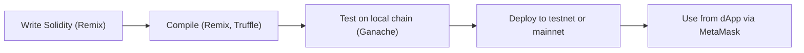

**In simple words:** Development tools help a programmer write, test and run smart contracts. Remix is an online editor, Ganache is a practice blockchain on your computer, and Truffle is a toolkit that ties them together. <Cite id="web-bt-sol-b-gfg-eth-tools" />

**Why tools are needed:** smart contracts are written in Solidity and compiled into bytecode that the EVM can run, then deployed to a network. <Cite id="class-bt-m3a" loc="slide 16" />

**Main tools:**

1. **Remix IDE.** A browser-based Ethereum IDE for Solidity. It needs no setup, has plugins, and can compile, deploy and debug contracts. *Use:* learning and quick tests. <Cite id="solidity-remix-docs" />
2. **Ganache.** A personal blockchain for rapid Ethereum dApp development; a local, safe, repeatable test chain with ready test accounts. It has a desktop UI and a CLI. *Use:* test a contract without real money. <Cite id="ethereum-ganache-docs" />
3. **Truffle.** A framework to compile contracts, run tests and migrate (deploy) them from the command line; it works with Ganache. <Cite id="web-bt-sol-b-gfg-truffle-dapps" />
4. **MetaMask.** A browser wallet that holds keys and signs transactions for dApps. <Cite id="class-bt-m3a" loc="slide 15" />
5. **Hardhat and Foundry.** Modern frameworks that replaced Truffle for new projects. <Cite id="web-bt-sol-b-hardhat-docs" />
6. **Testnets and Etherscan.** Free test networks and a block explorer to view transactions. <Cite id="ethereum-alchemy-testnets" /> <Cite id="ethereum-etherscan-about" />

| Point | Remix | Ganache | Truffle |
|---|---|---|---|
| Type | Browser IDE | Local test blockchain | Framework |
| Job | Write, compile, deploy | Give a test chain and accounts | Compile, test, migrate |
| Install | Not needed | Yes | Yes (npm) |

<Cite id="ethereum-tp-ganache" /> <Cite id="web-bt-sol-b-gfg-ganache-truffle" />

**Extend in the exam (add these to reach 10 marks):**

- **Typical flow.** Start Ganache, write and compile the contract, deploy with Truffle, test it, then connect MetaMask and call it from a web page.
- **Hardhat and Foundry.** They start a local chain, compile, test and deploy; they are now the usual choice.
- **Library tools.** web3.js and ethers.js let a web page talk to the chain.
- **Important update.** Consensys announced in 2023 that Truffle and Ganache are being sunset and partnered with Hardhat. They are still taught, but new projects use Hardhat or Foundry. <Cite id="web-bt-sol-b-consensys-sunset" />

**Conclusion:** Remix, Ganache and Truffle take a contract from code to a tested, deployed dApp; Hardhat and Foundry now do the same job.
