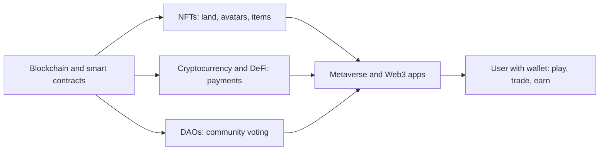

**In simple words:** The Metaverse is a shared 3D digital world. Web3 is a version of the internet where users own their data and assets. Blockchain provides the ownership and payments for both. <Cite id="class-bt-m5" loc="slide 52" /> <Cite id="web-bt-sol-b-eth-web3" />

**Metaverse.** A virtual universe of interconnected digital spaces, environments and assets. It is persistent and immersive. <Cite id="class-bt-m5" loc="slide 52" /> Key ideas: digital continuity, interoperability, user agency, persistence, economy and commerce. <Cite id="class-bt-m5" loc="slide 53" /> <Cite id="class-bt-m5" loc="slide 55" />

**Web3.** A decentralized internet built on blockchains where users sign in with a wallet instead of a company account. *Example:* connecting MetaMask to a dApp. <Cite id="class-bt-m3a" loc="slide 15" /> <Cite id="web-bt-sol-b-wiki-web3" />

**Use of blockchain:**

1. **Ownership with NFTs.** Land, art and avatars are NFTs; ownership cannot be copied. *Example:* virtual land in The Sandbox. <Cite id="class-bt-m5" loc="slide 60" />
2. **Virtual economy.** Cryptocurrencies and NFTs are used to buy, sell and trade. <Cite id="class-bt-m5" loc="slide 60" />
3. **Security and transparency.** The ledger stores NFT ownership and history. <Cite id="class-bt-m5" loc="slide 59" />
4. **Interoperability.** Assets such as avatars can be carried between virtual worlds. <Cite id="class-bt-m5" loc="slide 61" />
5. **Governance.** Communities vote through DAOs. <Cite id="web-bt-sol-b-wiki-dao" />
6. **Finance.** NFTs and tokens are used for trading, ownership and loans (DeFi). <Cite id="class-bt-m5" loc="slide 64" />

| Web2 | Web3 |
|---|---|
| Company owns accounts and data | User owns keys and assets |
| Login with email and password | Login with a wallet |
| Platform can remove items | Ownership recorded on chain |

**Extend in the exam (add these to reach 10 marks):**

- **Components of Metaverse.** Hardware, virtual world, avatars, blockchain, NFTs, virtual economy, AI, networking, interoperability. <Cite id="class-bt-m5" loc="slide 56" /> <Cite id="class-bt-m5" loc="slide 61" />
- **Applications.** Entertainment, commerce, healthcare, education, training, fashion, finance. <Cite id="class-bt-m5" loc="slide 62" /> <Cite id="class-bt-m5" loc="slide 63" />
- **Examples.** Decentraland, The Sandbox. <Cite id="class-bt-m5" loc="slide 57" />
- **Challenges.** Price volatility, scams, high fees, privacy and unclear law. <Cite id="cryptocurrencies-tokens-gfg-metaverse" />

**Conclusion:** Blockchain makes digital ownership, payment and community control possible in the Metaverse and Web3. <Cite id="cryptocurrencies-tokens-wiki-metaverse" />
