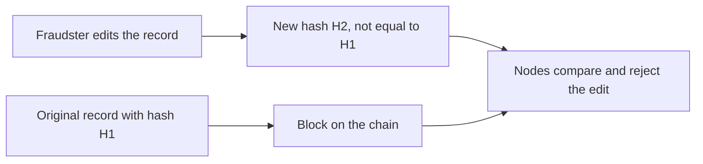

**In simple words:** Fraud needs hidden or changeable records. Blockchain keeps records visible to all members and nearly impossible to change quietly, so it makes fraud harder and trust easier. <Cite id="blockchain-fundamentals-ibm-blockchain" />

**How blockchain fights fraud and adds transparency:**

1. **Immutable records.** Each block holds the hash of the previous block, so changing old data breaks all later blocks. This prevents tampering and fraud. <Cite id="class-bt-m1" loc="slide 105" />
2. **Shared view.** All authorized participants see one common version of the records, which removes information gaps. <Cite id="class-bt-m6" loc="slide 25" />
3. **Digital signatures.** Each transaction is signed, so a fake sender is caught. <Cite id="blockchain-fundamentals-nakamoto" />
4. **Double-spending protection.** Consensus and the UTXO check stop one coin from being spent twice. <Cite id="wallets-utxo-double-spending-ibm-double-spend" />
5. **Time-stamped audit trail.** Every change is recorded with who and when, which helps auditors.
6. **Smart contracts.** Rules run automatically, so people cannot skip or bend them.
7. **No central point to corrupt.** Data is copied on many nodes.

**Examples in sectors:**

| Sector | Fraud problem | Blockchain role |
|---|---|---|
| Education | Fake certificates | Certificate checked against its blockchain record |
| Healthcare | Counterfeit medicines, false claims | Drug tracking and recorded claims |
| Real estate | Forged ownership records | Tamper-resistant property history |
| Supply chain | Fake goods | Authorized-path proof |
| Logistics | Altered shipment data | Tamper-resistant shipment records |
| Banking | Payment fraud | Fraud reduction in transfers |

<Cite id="class-bt-m6" loc="slide 4" /> <Cite id="class-bt-m6" loc="slide 12" /> <Cite id="class-bt-m6" loc="slide 13" /> <Cite id="class-bt-m6" loc="slide 16" /> <Cite id="class-bt-m6" loc="slide 20" /> <Cite id="class-bt-m1" loc="slide 6" />

**Extend in the exam (add these to reach 10 marks):**

- **Traceability.** Walmart traced a mango batch to its farm in about 2.2 seconds with IBM Food Trust, so bad sources are found fast. <Cite id="hyperledger-fabric-ibm-fabric" />
- **Product recall.** The source of a contaminated product is found quickly. <Cite id="class-bt-m6" loc="slide 25" />
- **Transparency versus privacy.** Public chains show all; private chains show data only to members. <Cite id="blockchain-applications-gfg-supply-revolution" />
- **Limits.** Blockchain proves a record was not changed, not that it was true when entered, and a 51% attack can still rewrite a small chain.

**Conclusion:** Blockchain combats fraud through immutable, shared, signed and time-stamped records, which also gives transparency.
