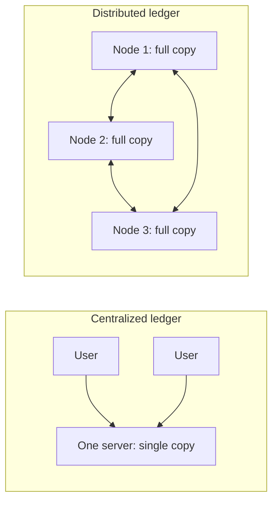

**In simple words:** a distributed ledger is a record book that many computers keep at the same time, so no one computer is the boss of the book.

**Definition:** a distributed ledger is a database that is shared, copied and synchronised across many nodes (computers) with no central administrator. Every participant holds the same copy, and the copies are kept equal by agreed rules. The blockchain ledger is replicated across a large number of nodes, is append-only and a new entry appears on all copies. <Cite id="blockchain-fundamentals-wiki-dlt" /> <Cite id="class-bt-m1" loc="slide 20" />

**Importance (need) in blockchain:**

1. **No single point of failure.** If one node crashes or is corrupted, the others still hold the data and alert everyone. <Cite id="class-bt-m1" loc="slide 19" /> **Example:** a bank server that is hacked loses all data; a distributed ledger does not.
2. **No trusted third party.** Everyone can check the data, so no bank is needed to keep the book. <Cite id="class-bt-m1" loc="slide 21" />
3. **Tamper resistance.** An attacker must change most copies at the same time. <Cite id="blockchain-fundamentals-nakamoto" />
4. **Transparency and audit.** All participants see the same history, so disputes are easy to settle.
5. **Stops double spending.** All nodes agree on one order of transactions, so a coin is not spent twice.
6. **One source of truth.** Miners solve a puzzle so everyone accepts a single version. <Cite id="class-bt-m1" loc="slide 22" />

| Point | Centralized ledger | Distributed ledger |
|---|---|---|
| Copies | One | Many, identical |
| Control | One administrator | Shared by nodes |
| Failure | Single point of failure | Survives node failures |
| Tampering | Admin can edit | Needs most copies changed |

**Extend in the exam (add these to reach 10 marks):**

- **Blockchain is one type of DLT.** Blocks, hash links and consensus are added; some ledgers use other structures. <Cite id="blockchain-fundamentals-nist-8202" />
- **How copies stay equal.** Broadcast, validate, consensus, then every node adds the same block.
- **Example.** Bitcoin's ledger runs on thousands of nodes worldwide. <Cite id="blockchain-fundamentals-gfg-intro" />
- **Cost.** Updates are slower because nodes must agree.

**Conclusion:** the distributed ledger removes the middleman by making the record shared, verifiable and hard to change.
