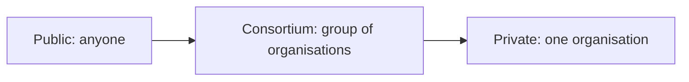

**In simple words:** the three types differ in who may join and who is in charge: everyone, one owner or a group.

1. **Public blockchain.** No one is in charge; anyone can read, write and audit. It is fully decentralised but slow and energy hungry. **Example:** Bitcoin, Ethereum. <Cite id="class-bt-m1" loc="slide 53" /> <Cite id="class-bt-m1" loc="slide 56" />
2. **Private blockchain.** One organisation controls who reads or writes; closed network, fast and private, less decentralised. **Example:** Hyperledger, a bank chain. <Cite id="class-bt-m1" loc="slide 58" />
3. **Consortium blockchain.** More than one organisation manages it; also called federated; part public, part private. **Example:** R3, Energy Web Foundation. <Cite id="class-bt-m1" loc="slide 66" />

| Point | Public | Private | Consortium |
|---|---|---|---|
| Control | None | One owner | Group |
| Speed | Slow | Fast | Fast |
| Privacy | Low | High | Medium |
| Example | Bitcoin | Internal ledger | Corda |

<Cite id="blockchain-fundamentals-gfg-types" /> <Cite id="private-blockchain-gfg-pubpriv" />

**Conclusion:** public is open, private is controlled and consortium is shared; pick by trust and speed needs. <Cite id="private-blockchain-gfg-consortium" />
