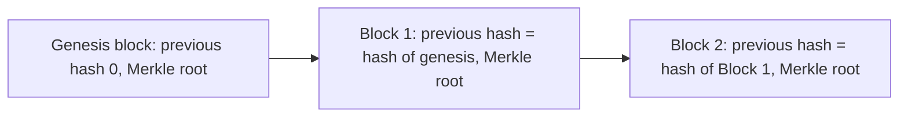

**In simple words:** a blockchain is a chain of blocks, where each block remembers the fingerprint of the one before it. Inside each block, a Merkle tree summarises its transactions.

**Definition:** a blockchain is a shared, tamper-proof digital ledger that securely stores data across a decentralized network of computers; participants use cryptography and consensus to record transactions in blocks that are permanently linked together. <Cite id="class-bt-m1" loc="slide 10" />

**Data structure used:** <Cite id="blockchain-fundamentals-gfg-structure" />

1. **Block.** The basic unit, with a **header** (version, previous hash, timestamp, nonce, nBits, Merkle root) and a **body** (transaction counter and transactions). <Cite id="class-bt-m1" loc="slide 69" /> <Cite id="class-bt-m1" loc="slide 70" />
2. **Linked list with hash pointers.** Each block stores the hash of the previous block header; the first block (genesis) has previous hash 0. Result: a chain of blocks. <Cite id="class-bt-m1" loc="slide 103" /> <Cite id="class-bt-m1" loc="slide 104" />
3. **Merkle tree inside each block.** Transaction hashes are paired and hashed upward to one Merkle root stored in the header. <Cite id="class-bt-m1" loc="slide 108" />
4. **Append-only.** New blocks are only added at the end. <Cite id="class-bt-m1" loc="slide 20" />

| Structure | Purpose |
|---|---|
| Hash pointer chain | Tamper evidence: change one block and all later links break |
| Merkle tree | Summary of transactions and light verification |
| Append-only list | History never edited |

**Extend in the exam (add these to reach 10 marks):**

- **Linking matters.** Changing a block changes its hash, so all next blocks become invalid; this gives immutability and security. <Cite id="class-bt-m1" loc="slide 105" />
- **Block height.** Genesis is height 0. <Cite id="class-bt-m1" loc="slide 94" />
- **Hash function.** Fixed-length output used for TxID, block hash and linking. <Cite id="class-bt-m1" loc="slide 32" />
- **Merkle proof.** Verify one transaction with a few hashes. <Cite id="class-bt-m1" loc="slide 109" />

**Conclusion:** a blockchain is a hash-linked list of blocks, each holding a Merkle tree of transactions, kept by many nodes. <Cite id="blockchain-fundamentals-ibm-blockchain" />
