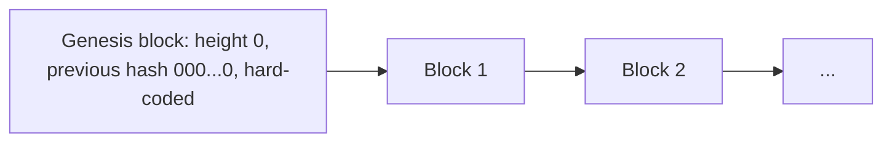

**In simple words:** the genesis block is page one of the blockchain notebook. Every later page links back to it, and it has no page before it.

**Definition:** the genesis block is the very first block in a blockchain, also called Block 0. It is the foundation of the network and sets its initial rules; unlike other blocks it does not refer to a previous block. <Cite id="class-bt-m1" loc="slide 98" />

**Key characteristics:** <Cite id="class-bt-m1" loc="slide 99" /> <Cite id="class-bt-m1" loc="slide 100" />

1. **First block.** All other blocks are added after it.
2. **No previous block hash.** Its previous hash field is set to 0 or null.
3. **Hardcoded.** It is predefined in the software, not mined like normal blocks.
4. **Foundation.** All blocks link to it, directly or indirectly.
5. **Height 0.** Genesis always has block height 0. <Cite id="class-bt-m1" loc="slide 101" />

**Example (Bitcoin):** created by Satoshi Nakamoto on 3 January 2009. It carries the message "The Times 03/Jan/2009 Chancellor on brink of second bailout for banks", which proves the creation time and hints at the purpose. <Cite id="class-bt-m1" loc="slide 101" /> <Cite id="block-structure-merkle-btcwiki-genesis" />

| Genesis block | Other blocks |
|---|---|
| Previous hash is 0 | Previous hash is the earlier block's hash |
| Hardcoded in software | Created by mining or validation |
| Height 0 | Height 1 and above |

**Extend in the exam (add these to reach 10 marks):**

- **Why needed.** The chain needs a common starting point that all nodes agree on; a node validates by walking back to it. <Cite id="class-bt-m1" loc="slide 101" />
- **Importance.** It is the root of the chain, establishes initial trust and ensures continuity. <Cite id="class-bt-m1" loc="slide 101" />
- **Content.** One coinbase transaction (50 BTC, which cannot be spent). <Cite id="block-structure-merkle-core-chainparams" />
- **Other chains.** Ethereum created its genesis block in 2015; private chains define theirs in a genesis file. <Cite id="class-bt-m3a" loc="slide 3" /> <Cite id="block-structure-merkle-gfg-genesis" />

**Conclusion:** the genesis block anchors the whole chain; every block can be traced back to it.
