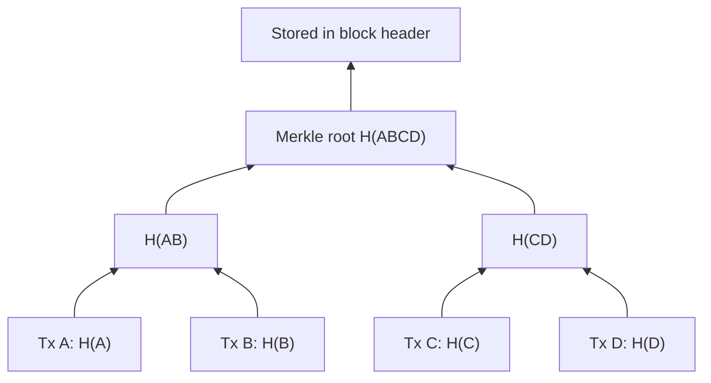

**In simple words:** a Merkle tree squeezes thousands of transactions into one short fingerprint, the Merkle root. If any transaction changes, the fingerprint changes.

**Definition:** a Merkle tree is a data structure that organises a large amount of transaction data into a single, secure digital fingerprint called the Merkle root. It lets the blockchain verify data and prove that a transaction belongs in a block without downloading the whole ledger. <Cite id="class-bt-m1" loc="slide 107" />

**Structure (bottom to top):** <Cite id="class-bt-m1" loc="slide 108" />

1. **Leaves.** Hash every transaction (SHA-256): H(A), H(B), H(C), H(D).
2. **Branches.** Pair the hashes and hash each pair: H(AB) = H(H(A) + H(B)), H(CD) likewise.
3. **Repeat** upward like an inverted pyramid.
4. **Merkle root.** One hash at the top, stored in the block header as a tamper-proof summary.
5. **Odd count.** The last hash is paired with a copy of itself (Bitcoin). <Cite id="block-structure-merkle-mb-ch11" />

**Why it matters:** <Cite id="class-bt-m1" loc="slide 109" />

| Benefit | How |
|---|---|
| Tamper-proofing | One changed comma changes hashes up to the root |
| Light verification | Merkle proof: only the root and a few branch hashes needed |
| Small header | 32 bytes stand for all transactions |

**Extend in the exam (add these to reach 10 marks):**

- **Merkle proof.** To show C is in the block, send H(D) and H(AB): 2 hashes for 4 transactions, about log2(n) for n. 
- **Count.** n leaves give 2n - 1 hashes in total (4 gives 7).
- **Used by.** Bitcoin and Ethereum headers; Ethereum uses the Merkle Patricia trie for state.
- **Light clients.** Mobile wallets verify payments with the root plus a proof. <Cite id="block-structure-merkle-gfg-merkle-intro" />

**Conclusion:** a Merkle tree summarises many transactions in one root and makes checking and tamper detection fast. <Cite id="block-structure-merkle-wiki-merkle" />
