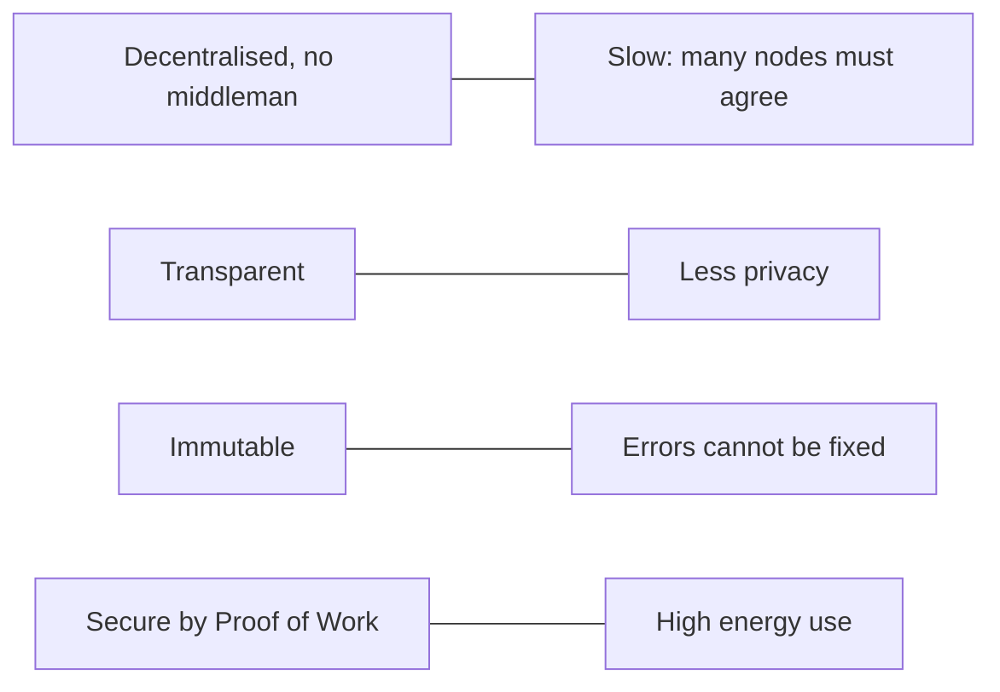

**In simple words:** blockchain gives safe, shared records without a middleman, but the same design makes it slow, heavy and hard to correct.

**Benefits:**

1. **Decentralization.** No central authority; participants hold and approve the data. <Cite id="class-bt-m1" loc="slide 19" />
2. **Transparency.** Everyone with access sees the same ledger.
3. **Immutability.** Append-only; a change breaks all later blocks. <Cite id="class-bt-m1" loc="slide 27" /> <Cite id="class-bt-m1" loc="slide 105" />
4. **Security.** Hashing and digital signatures protect data and ownership. <Cite id="class-bt-m1" loc="slide 11" />
5. **Traceability.** Time-stamped records help track products. <Cite id="class-bt-m1" loc="slide 7" />
6. **Lower cost and faster settlement.** No middlemen, so fewer fees and quicker transfers. <Cite id="class-bt-m1" loc="slide 6" />
7. **Fraud reduction and automation** with smart contracts.

**Limitations:**

1. **Slow and low scalability.** Every node verifies everything; public chains are slow. <Cite id="class-bt-m1" loc="slide 56" />
2. **High energy use** with Proof of Work. <Cite id="class-bt-m2" loc="slide 39" />
3. **Storage.** Large files are inefficient and expensive to keep on chain. <Cite id="class-bt-m3b" loc="slide 24" />
4. **Privacy.** Public ledgers show all data.
5. **Cannot undo mistakes** and a 51% attack is a risk. <Cite id="class-bt-m2" loc="slide 41" />
6. **Rules and skills.** Unclear regulation, few skilled developers.

| Benefit | Matching limitation |
|---|---|
| Decentralisation | Slow agreement |
| Transparency | Less privacy |
| Immutability | Mistakes stay |
| Security by PoW | Energy cost |

<Cite id="blockchain-fundamentals-gfg-advantages" />

**Extend in the exam (add these to reach 10 marks):**

- **Scale numbers.** Bitcoin handles about 7 transactions per second, Ethereum about 15 to 30, card networks thousands. <Cite id="blockchain-fundamentals-nist-8202" />
- **Fixes.** Proof of Stake cuts energy; layer 2 helps speed; off-chain storage (Swarm, IPFS) for files. <Cite id="class-bt-m3b" loc="slide 25" />
- **Centralization risk.** Private chains are fast but less decentralised. <Cite id="class-bt-m1" loc="slide 51" />
- **Energy.** Measured by the Cambridge index. <Cite id="blockchain-fundamentals-ccaf-cbeci" />

**Conclusion:** blockchain is best where trust, transparency and traceability matter more than raw speed and privacy. <Cite id="blockchain-fundamentals-ibm-blockchain" />
