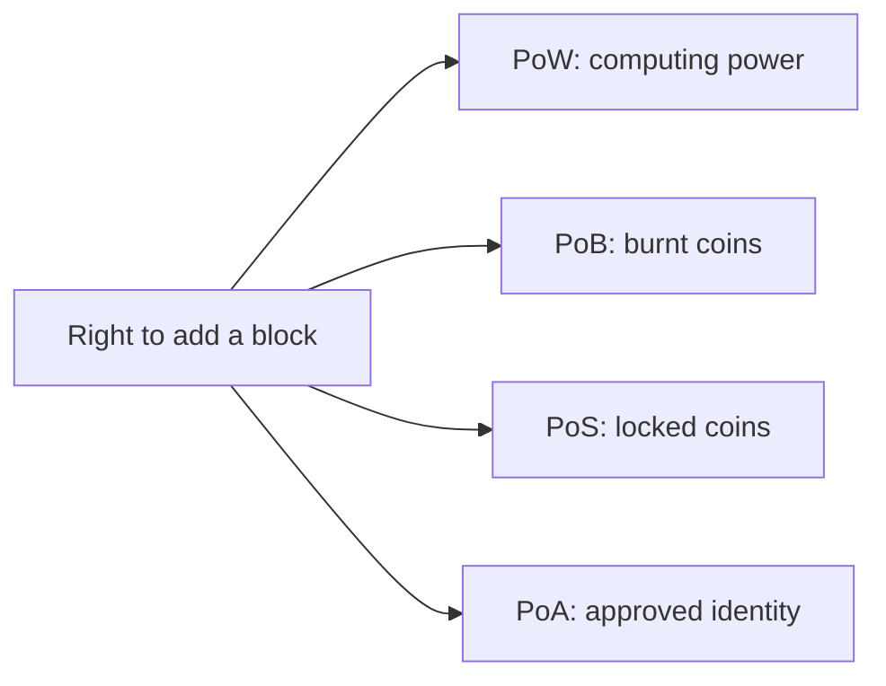

**In simple words:** a consensus protocol decides who adds the next block. The four protocols differ in what a node must put at stake: computing power, coins locked, coins burnt or a trusted identity.

1. **Proof of Work (PoW).** Miners find a nonce so the block hash is below a target; the first wins the reward. **Example:** Bitcoin. <Cite id="class-bt-m2" loc="slide 27" />
2. **Proof of Burn (PoB).** Nodes send coins to an unspendable address; the more burnt, the higher the chance to be chosen. It aims to avoid the energy cost of mining. <Cite id="class-bt-m2" loc="slide 62" /> <Cite id="class-bt-m2" loc="slide 63" />
3. **Proof of Stake (PoS).** Validators lock coins; one is chosen by stake and randomness; cheating loses the stake. **Example:** Ethereum. <Cite id="class-bt-m2" loc="slide 42" />
4. **Proof of Authority (PoA).** A few approved, known validators sign blocks; identity and reputation are the stake. <Cite id="class-bt-m2" loc="slide 57" /> <Cite id="class-bt-m2" loc="slide 58" />

| Point | PoW | PoB | PoS | PoA |
|---|---|---|---|---|
| Winner chosen by | First to solve puzzle | Amount burnt | Stake plus randomness | Approved validators in turn |
| Resource at stake | Hardware, electricity | Burnt coins | Locked coins | Reputation, identity |
| Energy | Very high | Low | Very low | Very low |
| Speed | Slow | Medium | Faster | Very fast |
| Decentralisation | High | Medium | Medium to high | Low |
| Main risk | 51% attack, energy waste | Coins lost for ever | Rich get richer | Few validators can collude |
| Network | Public | Public | Public | Private or test |
| Example | Bitcoin | Slimcoin | Ethereum | Private chains |

<Cite id="consensus-mining-gfg-crypto-consensus" /> <Cite id="consensus-mining-gfg-pob" />

**Extend in the exam (add these to reach 10 marks):**

- **Advantages.** PoW secure and proven; PoS energy efficient; PoB no electricity waste; PoA fast. <Cite id="class-bt-m2" loc="slide 37" /> <Cite id="class-bt-m2" loc="slide 47" /> <Cite id="class-bt-m2" loc="slide 66" /> <Cite id="class-bt-m2" loc="slide 61" />
- **Disadvantages.** PoW energy and pools; PoS nothing-at-stake; PoB wasted coins; PoA centralisation. <Cite id="class-bt-m2" loc="slide 39" /> <Cite id="class-bt-m2" loc="slide 49" />
- **Ethereum Merge.** Cut energy by about 99.95%. <Cite id="class-bt-m3a" loc="slide 4" />
- **Choosing.** Open public chains use PoW or PoS; known parties can use PoA. <Cite id="consensus-mining-eth-poa" />

**Conclusion:** PoW is the most proven but costly; PoS and PoB save energy; PoA is fastest but trusts a few parties.
