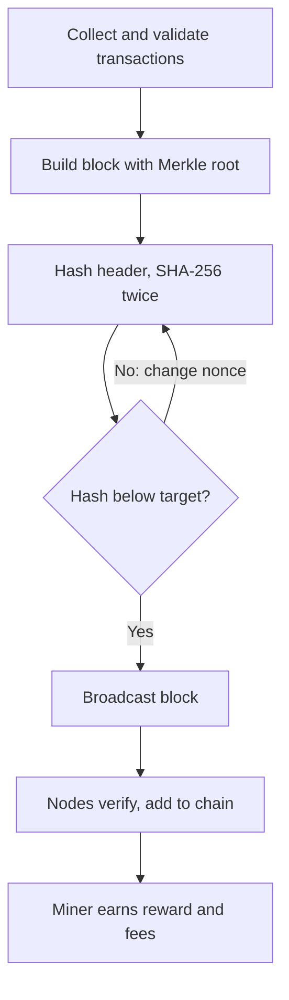

**In simple words:** miners are like auditors who also solve a puzzle. The fastest one to solve it adds the next page to the ledger and earns coins.

**Definition:** mining is the process of verifying bitcoin transactions and storing them in the blockchain; it also creates new bitcoin. <Cite id="class-bt-m2" loc="slide 123" /> Miners are "bank auditors plus puzzle solvers". <Cite id="class-bt-m2" loc="slide 84" />

**Steps of mining:** <Cite id="class-bt-m2" loc="slide 30" /> <Cite id="class-bt-m2" loc="slide 80" /> <Cite id="class-bt-m2" loc="slide 81" />

1. **Receive transactions.** Users broadcast them; miners collect them from the mempool.
2. **Verify.** Check signatures and balance; reject invalid or fraudulent ones.
3. **Create a block.** Group valid transactions; header has previous hash, timestamp and Merkle root.
4. **Solve the puzzle.** Find a nonce so Hash(block header) is below the target; this needs high computing power.
5. **Broadcast.** Send the block to the network.
6. **Verify and add.** Other nodes check it (one hash) and add it to their chain.
7. **Reward.** Block reward (new bitcoin) plus transaction fees. <Cite id="class-bt-m2" loc="slide 82" />

**Extend in the exam (add these to reach 10 marks):**

- **Challenges.** High energy, competition, hardware cost (ASICs, GPUs) and difficulty adjustment. <Cite id="class-bt-m2" loc="slide 83" />
- **Importance.** Secures the chain, keeps decentralisation, prevents fraud and double spending. <Cite id="class-bt-m2" loc="slide 84" />
- **Difficulty.** Adjusted every 2016 blocks to keep one block per 10 minutes. <Cite id="class-bt-m2" loc="slide 92" />
- **Mining pools.** Small miners share work and rewards by PPS, PPLNS or FPPS. <Cite id="class-bt-m2" loc="slide 98" /> <Cite id="class-bt-m2" loc="slide 105" />
- **Consensus and forks.** The chain with most work wins; about 6 confirmations are treated as final. <Cite id="consensus-mining-btcwiki-confirmation" /> 

| Strength | Weakness |
|---|---|
| Open to anyone | Huge energy use |
| Very secure | About 10 minutes per block |
| Simple rule: most work wins | Pools concentrate power |

**Conclusion:** mining makes block creation costly and checking cheap, which secures Bitcoin and rewards honest miners. <Cite id="bitcoin-mb-ch12-mining" />
