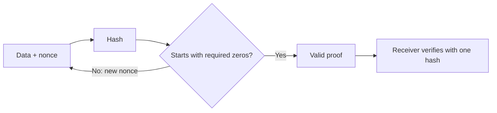

**In simple words:** Bitcoin is internet cash with no bank. Hashcash is the "hard to do, easy to check" puzzle idea that Bitcoin borrowed to protect its blocks.

**Bitcoin:** a decentralized digital currency that you can buy, sell and exchange directly, without an intermediary like a bank. Satoshi Nakamoto described it in 2008 as an electronic payment system based on cryptographic proof instead of trust; it launched in January 2009. Every transaction is on a public ledger, hard to reverse and difficult to fake. <Cite id="class-bt-m2" loc="slide 108" /> <Cite id="class-bt-m2" loc="slide 109" /> <Cite id="class-bt-m2" loc="slide 110" />

**Hashcash:** a Proof-of-Work mechanism that requires a computer to solve a puzzle before an action, such as adding a block. Finding the solution is hard; verifying it is easy. <Cite id="class-bt-m2" loc="slide 128" />

**How hashcash works:** <Cite id="class-bt-m2" loc="slide 129" />

1. Take the input data.
2. Add a nonce (a changing number).
3. Apply a hash function such as SHA-256.
4. Check the condition, for example the hash starts with 0000.
5. If not, change the nonce and repeat.
6. When the condition is met, the solution is valid.

**Role of hashcash in Bitcoin:** <Cite id="class-bt-m2" loc="slide 130" />

1. Used in **Bitcoin mining**: miners solve hashcash-style puzzles to add blocks and earn rewards.
2. Keeps the network **secure**: cheating needs huge work.
3. **Builds trust without a central authority.**
4. **Prevents spam and attacks.**

| | Hashcash | Bitcoin PoW |
|---|---|---|
| Purpose | Stop spam e-mail | Agree on next block |
| Work on | E-mail header | Block header |
| Hash | SHA-1 | Double SHA-256 |
| Reward | None | Block reward and fees |

<Cite id="bitcoin-wiki-hashcash" />

**Extend in the exam (add these to reach 10 marks):**

- **Origin.** Adam Back proposed it in 1997 to stop e-mail spam. <Cite id="bitcoin-hashcash-back" />
- **Features of Bitcoin.** Decentralised, 21 million cap, pseudonymous, block every 10 minutes.
- **Block puzzle.** Hash of header must be below a target; difficulty changes every 2016 blocks. <Cite id="bitcoin-gfg-pow" />
- **Whitepaper.** Nakamoto cites hashcash-like proof of work. <Cite id="blockchain-fundamentals-nakamoto" loc="§4" />

**Conclusion:** Bitcoin is peer-to-peer digital cash, and hashcash gives it the costly-to-make, cheap-to-check work that secures the chain.
