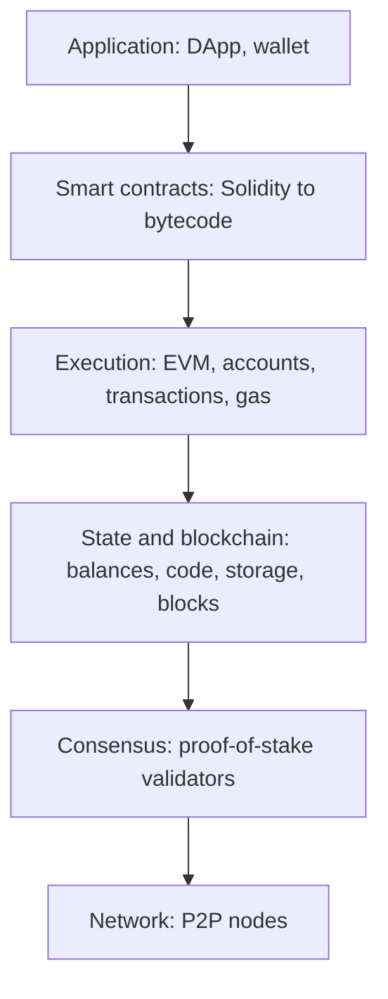

**In simple words:** Ethereum is one shared computer kept in step by thousands of nodes. People send transactions to it, the EVM runs the contract code and gas pays for the work.

**Definition:** Ethereum is a decentralized blockchain platform that lets users transfer cryptocurrency and also run smart contracts and decentralized applications (DApps). Think of it as a distributed computer: the EVM is the computing environment and thousands of nodes keep the same state. <Cite id="class-bt-m3a" loc="slide 13" /> <Cite id="ethereum-whitepaper" />

**Architecture in layers (top to bottom):**

1. **Application layer.** DApps, wallets such as MetaMask, DeFi and NFT apps; a front end plus smart-contract back end. <Cite id="class-bt-m3a" loc="slide 15" />
2. **Smart contract layer.** Programs in Solidity compiled to bytecode; they store data, receive transactions and call other contracts. <Cite id="class-bt-m3a" loc="slide 17" />
3. **Execution layer.** The **EVM** runs the code the same way on every node; it also holds **accounts** (EOA and contract), **transactions** and **gas**. <Cite id="class-bt-m3a" loc="slide 19" /> <Cite id="ethereum-eth-evm" />
4. **Consensus layer.** Proof of Stake: validators propose and attest blocks. <Cite id="class-bt-m3a" loc="slide 27" />
5. **Network layer.** Peer-to-peer nodes pass transactions and blocks. <Cite id="class-bt-m3a" loc="slide 29" />
6. **Blockchain and state layer.** The chain of blocks plus the state (balances, contract code, storage). <Cite id="class-bt-m3a" loc="slide 31" />

**Key components:** <Cite id="class-bt-m3a" loc="slide 5" />

| Component | Role |
|---|---|
| Nodes | Full, light and archive nodes keep and verify the chain |
| EVM | Decentralized runtime that executes contracts |
| Accounts | EOA (private key) and contract account (code) |
| Ether (ETH) | Native coin, pays for work |
| Gas | Measures computation; fee = gas used x gas price |
| Transactions | Signed instructions that change state |

<Cite id="ethereum-gfg-components" />

**Extend in the exam (add these to reach 10 marks):**

- **Why gas.** It pays for computation, stops unlimited loops and discourages spam. <Cite id="class-bt-m3a" loc="slide 26" /> <Cite id="ethereum-eth-gas" />
- **Transaction uses.** Transfer ETH, deploy a contract or call a function. <Cite id="class-bt-m3a" loc="slide 24" />
- **Consensus history.** Proof of Work until the Merge in 2022, then Proof of Stake. <Cite id="class-bt-m3a" loc="slide 33" />
- **State.** Stored in a Merkle Patricia trie; the state root goes in each block header. <Cite id="class-bt-m3a" loc="slide 32" />
- **Workflow.** Sign, send, gossip, include in a block, execute in the EVM, settle, finalise. <Cite id="ethereum-eth-stack" />

**Conclusion:** accounts, transactions, the EVM, gas, state and a staking network together make Ethereum a programmable blockchain.
