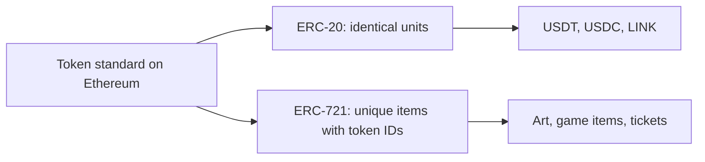

**In simple words:** an ERC-20 token is like a rupee note: every unit is the same. An ERC-721 token is like a land deed: each one is unique.

1. **ERC-20 (fungible).** A standard for fungible tokens; each token is interchangeable with a similar one. Required functions: totalSupply, balanceOf, transfer, transferFrom, approve, allowance; events Transfer and Approval. <Cite id="class-bt-m5" loc="slide 14" /> <Cite id="class-bt-m5" loc="slide 16" /> **Example:** USDT, USDC, in-game currency. <Cite id="class-bt-m5" loc="slide 21" />
2. **ERC-721 (non-fungible).** A standard for NFTs; each token is unique and individually identifiable by a Token ID. Functions: balanceOf, ownerOf, transferFrom, safeTransferFrom, approve, getApproved, setApprovalForAll, isApprovedForAll. <Cite id="class-bt-m5" loc="slide 22" /> <Cite id="class-bt-m5" loc="slide 24" /> **Example:** digital artwork Token ID 101 owned by Alice. <Cite id="class-bt-m5" loc="slide 27" />
3. **Why a standard.** Wallets, exchanges and DApps support every token that follows the same interface. <Cite id="class-bt-m5" loc="slide 20" />

| Point | ERC-20 | ERC-721 |
|---|---|---|
| Token type | Fungible | Non-fungible |
| Identity | All units same | Unique Token ID |
| Divisible | Yes | No |
| Balance | One number per address | List of owned token IDs |
| Main functions | transfer, approve, allowance, transferFrom | ownerOf, safeTransferFrom, approve, getApproved |
| Use | Currency, utility, stablecoins | Art, collectibles, tickets, certificates, game items |
| Examples | USDT, LINK | CryptoKitties, art NFTs |

<Cite id="cryptocurrencies-tokens-gfg-erc-vs" />

**Extend in the exam (add these to reach 10 marks):**

- **approve plus transferFrom.** Lets a spender move tokens up to an allowance (ERC-20) or one NFT (ERC-721). <Cite id="cryptocurrencies-tokens-eip20" />
- **What the contract tracks.** ERC-20: total supply, balances, transfers. ERC-721: token IDs, owners, approved addresses, metadata. <Cite id="class-bt-m5" loc="slide 26" />
- **Benefits.** ERC-20: standardisation, easy integration, interoperability. <Cite id="class-bt-m5" loc="slide 20" /> ERC-721: proves unique ownership. <Cite id="class-bt-m5" loc="slide 28" />
- **Metadata.** An NFT usually points to its file stored off-chain. <Cite id="cryptocurrencies-tokens-eip721" />

**Conclusion:** ERC-20 suits money-like tokens; ERC-721 suits unique items.
