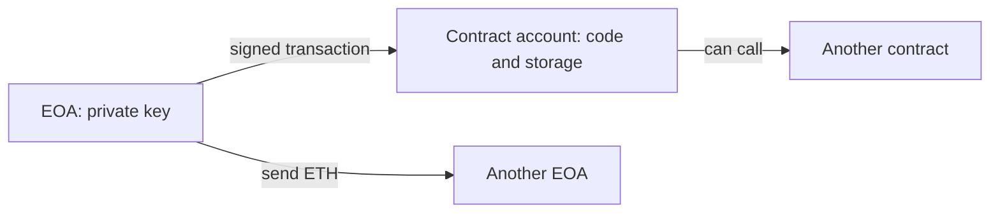

**In simple words:** an Ethereum account is an identity that can hold ether. A person's account is opened by a private key; a contract's account is run by its code.

Ethereum has two types of accounts. <Cite id="class-bt-m3a" loc="slide 42" />

1. **Externally Owned Account (EOA).** Managed by a private key, usually by a person. It has an address, private key, balance and nonce. It can send ETH, interact with contracts and deploy contracts. **Uses:** personal wallets, using DApps, DeFi. **Example:** a MetaMask account. <Cite id="class-bt-m3a" loc="slide 43" /> <Cite id="class-bt-m3a" loc="slide 44" />
2. **Contract account.** Controlled by smart contract code, not by a private key. It has an address, code, balance and internal state, and runs functions when called. **Uses:** DApps, DeFi, token contracts (ERC-20 and ERC-721). <Cite id="class-bt-m3a" loc="slide 45" /> <Cite id="class-bt-m3a" loc="slide 46" />

| Point | EOA | Contract account |
|---|---|---|
| Controlled by | Private key | Contract code |
| Has code | No | Yes |
| Can start a transaction | Yes | No, only reacts when called |
| Cost to create | Free | Gas to deploy |
| Example | MetaMask wallet | Token or voting contract |

<Cite id="ethereum-gfg-accounts" />

**Extend in the exam (add these to reach 10 marks):**

- **Four fields in every account.** nonce, balance, storageRoot, codeHash. <Cite id="ethereum-me-ch6" />
- **Nonce.** Counts transactions sent, keeps them in order and stops replay. <Cite id="class-bt-m3a" loc="slide 44" />
- **Together.** Every action starts with an EOA; contracts react and can call other contracts. <Cite id="ethereum-eth-accounts" />
- **Common mistake.** A contract account has no private key. <Cite id="class-bt-m3a" loc="slide 22" />

**Conclusion:** EOAs are the users who act, and contract accounts are the programs that react.
