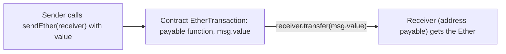

**In simple words:** the program takes Ether that a sender attaches to a function call and passes it on to a receiver address.

**Algorithm:**

1. The sender calls `sendEther(receiver)` and attaches Ether.
2. `payable` lets the function accept that Ether (`msg.value`).
3. The contract sends `msg.value` to the `receiver`.
4. The receiver's balance rises and the sender's falls by the amount plus gas. <Cite id="class-bt-m3a" loc="slide 57" />



```solidity
// SPDX-License-Identifier: MIT
pragma solidity ^0.8.0;

contract EtherTransaction {
    // payable function: the call can carry Ether; address payable: receiver can get Ether
    function sendEther(address payable receiver) public payable {
        // pass the Ether that came with this call on to the receiver
        receiver.transfer(msg.value);
    }
}
```

**Keywords:** <Cite id="class-bt-m3a" loc="slide 56" />

1. `contract EtherTransaction` creates the contract that handles Ether transactions.
2. `address payable receiver` is the receiver's address; `payable` means it can receive Ether. <Cite id="solidity-docs-types" />
3. `public` lets the function be called from outside.
4. `payable` on the function lets it receive Ether with the call.
5. `msg.value` is the amount sent with the call. <Cite id="solidity-docs-units-globals" />
6. `receiver.transfer(msg.value)` sends that amount to the receiver.

<Box kind="verify">

**Dry run:** Asha calls `sendEther(Bob)` with 1 ETH. `msg.value` is 1 ETH (10^18 wei). The contract runs `Bob.transfer(1 ETH)`. Bob gains 1 ETH, the contract keeps 0, Asha pays 1 ETH plus gas.

</Box>

| Word | Meaning |
|---|---|
| `payable` | Can receive Ether |
| `msg.value` | Ether sent with the call (in wei) |
| `msg.sender` | Address of the caller |
| `transfer` | Sends Ether, reverts on failure |

**Extend in the exam (add these to reach 10 marks):**

- **Receiving Ether.** Add `receive() external payable {}` so the contract accepts plain Ether. <Cite id="solidity-gfg-intro" />
- **Safer sending.** Today `call` is preferred: `(bool ok, ) = receiver.call{value: msg.value}(""); require(ok);`. `transfer` forwards only 2300 gas. <Cite id="web-bt-sol-a-sbe-send" />
- **Check amount.** `require(msg.value > 0, "Send some Ether");` stops empty transfers.
- **Check balance.** `address(this).balance` shows the contract's Ether. <Cite id="solidity-by-example" />
- **Re-entrancy.** Update balances before sending Ether to avoid attacks. <Cite id="smart-contracts-sol-security" />

**Conclusion:** `payable` brings Ether in, `msg.value` tells how much and `transfer` sends it out.
