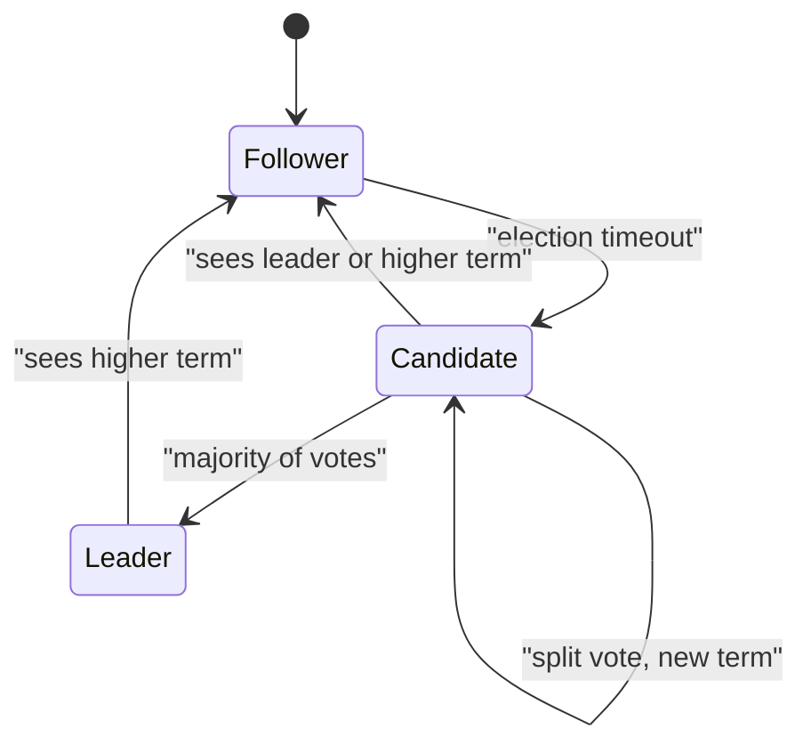

**In simple words:** Raft is a consensus algorithm that makes a group of servers keep the same log of commands in the same order, even if some servers crash. One server is the leader and the others follow it. It was designed to be easier to understand than Paxos. <Cite id="class-bt-m4" loc="slide 71" /> <Cite id="bft-paxos-raft-raft-paper" />

**Why it is needed:** private blockchains have no mining. Known nodes must still agree on the next block, so they use a cheap voting algorithm like Raft. It handles crash faults only, not lying nodes. <Cite id="bft-paxos-raft-raft-site" />

**How Raft works:**

1. **Three roles.** Follower (passive), Candidate (wants to lead) and Leader (takes client commands). Time is split into numbered **terms**; each term has at most one leader.
2. **Leader election.** The leader sends regular heartbeats. A follower that hears none for a random timeout (about 150 to 300 ms) becomes a candidate, adds 1 to the term, votes for itself and asks for votes. A **majority** of votes makes it leader. <Cite id="bft-paxos-raft-gfg-raft" />
3. **Log replication.** The client sends a command to the leader. The leader appends it and sends it to followers (AppendEntries). When a majority has stored it, the entry is **committed** and applied.
4. **Safety.** A candidate with an out-of-date log cannot win, so committed entries are never lost.

**Example (5 servers):** a leader needs 3 copies to commit. The cluster still works with 2 servers down. If the leader crashes, another server starts a new term and wins with 3 votes; it already holds the committed entries.

| Point | Raft | Paxos |
|---|---|---|
| Faults handled | Crash | Crash |
| Nodes for f faults | 2f + 1 | 2f + 1 |
| Leader | Strong leader | Not required |
| Ease | Easy | Hard |

**Extend in the exam (add these to reach 10 marks):**

- **Random timeouts.** They make split votes rare because one server usually times out first. <Cite id="bft-paxos-raft-raft-paper" />
- **Vote rule.** A server votes for at most one candidate per term, and only if the candidate's log is as up to date as its own.
- **Use in blockchains.** Hyperledger Fabric's ordering service and Quorum use Raft. <Cite id="bft-paxos-raft-fabric-orderer" /> <Cite id="corda-ripple-quorum-quorum-ibft" />
- **Limits.** All writes pass through the leader, and malicious nodes are not handled (use PBFT). <Cite id="bft-paxos-raft-wiki-raft" />

**Conclusion:** Raft elects a leader, copies its log to a majority and so keeps all servers consistent.
