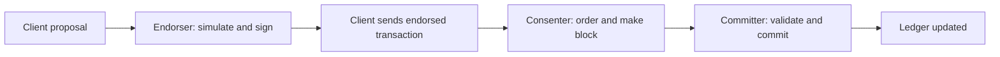

**In simple words:** Hyperledger is a Linux Foundation project that offers tools for businesses to build their own private blockchains. Only the parties in a deal are connected and only their ledgers are updated. <Cite id="class-bt-m4" loc="slide 18" /> <Cite id="web-bt-sol-b-wiki-hyperledger" />

**What is Hyperledger?** It provides the platform to create personalized blockchain services for a business, supports distributed ledgers, includes many enterprise-ready permissioned platforms, and is a global collaboration for high-performance, reliable blockchain frameworks. <Cite id="class-bt-m4" loc="slide 18" />

**Why needed:** better efficiency of business processes, infrastructure and standards for industrial use, separation of sensitive data, less verification effort and better trust and scalability. <Cite id="class-bt-m4" loc="slide 20" />

**How it works:**

1. A requirement for a contract is started through an application.
2. The membership service validates the member.
3. The two concerned peers each produce a result and send it for consensus.
4. The results must be the same for the contract to be validated.
5. After validation the transaction happens and the ledgers of the affiliated peers are updated. <Cite id="class-bt-m4" loc="slide 21" /> <Cite id="class-bt-m4" loc="slide 22" />

*Example:* Alice sends a product to Bob. Her app queries the membership service and validates Bob, both parties produce the same result, it is ordered and verified, and the transaction is committed. <Cite id="class-bt-m4" loc="slide 23" />

**Roles of peers (three):** <Cite id="class-bt-m4" loc="slide 25" />

| Role | Job |
|---|---|
| Endorser | Simulates the transaction with chaincode and gives a signed response; the ledger is not changed yet. <Cite id="class-bt-m4" loc="slide 27" /> |
| Consenter (orderer) | Puts transactions in one order, packs them into blocks and delivers them; it does not run the contract. <Cite id="class-bt-m4" loc="slide 29" /> |
| Committer | Validates blocks against endorsement policy and appends them to the ledger; invalid transactions are marked but do not update the state. <Cite id="class-bt-m4" loc="slide 30" /> |

**Extend in the exam (add these to reach 10 marks):**

- **Example numbers.** Alice has Rs 500 and sends Rs 100. The endorser simulates 500 minus 100 = 400 and signs that result, without recording it yet. <Cite id="class-bt-m4" loc="slide 28" />
- **Members and CA.** Each organization has a Fabric CA certificate and runs authorized peers. <Cite id="class-bt-m4" loc="slide 43" />
- **Channels.** A private sub-network with its own ledger gives confidentiality. <Cite id="hyperledger-fabric-gfg-fabric" />
- **Note.** Hyperledger is an umbrella of projects (Fabric, Besu, Iroha, Indy), not one single blockchain. <Cite id="web-bt-sol-b-wiki-hyperledger" />

**Conclusion:** Hyperledger lets businesses run private, permissioned ledgers where endorsers, orderers and committers split the work.
