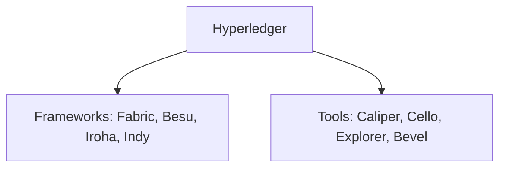

**In simple words:** Hyperledger has frameworks, which are the blockchains themselves, and tools, which help to deploy, test and watch them. <Cite id="class-bt-m4" loc="slide 31" />

**Tools** (deploy, manage, test, monitor and interact with networks): <Cite id="class-bt-m4" loc="slide 31" />

1. **Caliper:** performance testing and benchmarking; measures transactions per second (TPS) and latency. <Cite id="class-bt-m4" loc="slide 32" /> <Cite id="web-bt-sol-b-caliper" />
2. **Cello:** deploys and manages blockchain networks and reduces set-up effort. <Cite id="class-bt-m4" loc="slide 33" />
3. **Explorer:** graphical view of blocks, transactions, channels and participants for monitoring. <Cite id="class-bt-m4" loc="slide 34" />
4. **Bevel:** reusable scripts to automate deployment on cloud and other infrastructure, for Fabric and Besu. <Cite id="class-bt-m4" loc="slide 35" />

**Frameworks:** <Cite id="class-bt-m4" loc="slide 36" />

1. **Fabric:** enterprise permissioned blockchain with channels and chaincode. <Cite id="class-bt-m4" loc="slide 37" />
2. **Besu:** Ethereum client for public and private networks; supports Ethereum smart contracts and tools. <Cite id="class-bt-m4" loc="slide 38" /> <Cite id="web-bt-sol-b-besu" />
3. **Iroha:** simple platform for digital assets and identities. <Cite id="class-bt-m4" loc="slide 39" /> <Cite id="web-bt-sol-b-iroha" />
4. **Indy:** decentralized identity with verifiable credentials. <Cite id="class-bt-m4" loc="slide 40" /> <Cite id="web-bt-sol-b-indy" />

| Framework | Purpose | Example |
|---|---|---|
| Fabric | Enterprise permissioned chain | Supply-chain network |
| Besu | Ethereum-compatible | Banks' private Ethereum network |
| Iroha | Assets and identity | Digital assets and accounts |
| Indy | Decentralized identity | University certificate as credential |

**Note:** newer sources say some old Hyperledger projects have ended (Sawtooth archived in 2024), while Fabric, Besu, Iroha and Indy are active graduated projects. <Cite id="web-bt-sol-b-lfdt-projects" /> <Cite id="web-bt-sol-b-wiki-hyperledger" />

**Conclusion:** Frameworks give the blockchain; tools make it easier to test, deploy and monitor.
