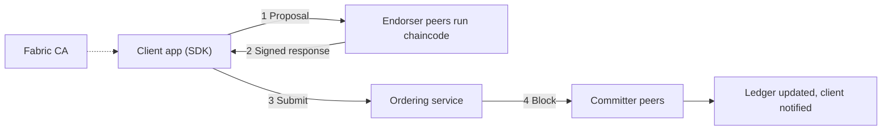

**In simple words:** Hyperledger Fabric is a permissioned blockchain for businesses. Smart contracts are called chaincode, and only approved organizations take part. <Cite id="class-bt-m4" loc="slide 41" />

**Definition:** Fabric is designed for enterprise applications. It is known for a modular architecture, a permissioned network and chaincode. It gives security, privacy and scalability for finance, supply chain and healthcare. Nodes validate transactions, keep the ledger and run chaincode. <Cite id="class-bt-m4" loc="slide 41" /> <Cite id="class-bt-m4" loc="slide 42" />

**Architecture (nine parts in class):** <Cite id="class-bt-m4" loc="slide 52" />

1. **Consensus layer:** agrees the order of transactions (T1 transfer before T2 receive).
2. **Smart contract layer:** chaincode holds the business rules and rejects invalid transactions. <Cite id="class-bt-m4" loc="slide 53" />
3. **Communication layer:** peers exchange messages securely using TLS. <Cite id="class-bt-m4" loc="slide 55" />
4. **Data store:** LevelDB (default key-value) or CouchDB (rich JSON queries). <Cite id="class-bt-m4" loc="slide 57" /> <Cite id="class-bt-m4" loc="slide 58" />
5. **Crypto abstraction:** hashing and digital signatures. <Cite id="class-bt-m4" loc="slide 59" />
6. **Identity service:** Fabric CA gives authentication and authorization. <Cite id="class-bt-m4" loc="slide 60" />
7. **Policy service:** endorsement policy decides who must approve. <Cite id="class-bt-m4" loc="slide 62" />
8. **API:** lets applications submit transactions and query data. <Cite id="class-bt-m4" loc="slide 64" />
9. **Interoperation:** lets different networks and systems exchange information. <Cite id="class-bt-m4" loc="slide 66" />

**Working (workflow):** (1) the client creates a proposal and sends it to endorsing peers; (2) peers check the member's certificate, run chaincode and return approval or rejection; (3) the client submits approved transactions to the ordering service, which puts them in a block and sends it to peers; (4) peers update their ledger and the transaction is committed. <Cite id="class-bt-m4" loc="slide 46" /> <Cite id="class-bt-m4" loc="slide 47" /> <Cite id="class-bt-m4" loc="slide 48" />

**Advantages:** security, privacy, scalability, modular design (consensus can be swapped), channels for private communication, no coin required. <Cite id="class-bt-m4" loc="slide 37" />

**Extend in the exam (add these to reach 10 marks):**

- **Ledger.** Blockchain (history) plus world state (latest values). <Cite id="hyperledger-fabric-ledger" />
- **Channels.** Private sub-networks with their own ledger. <Cite id="hyperledger-fabric-channels" />
- **Execute-order-validate.** The orderer never runs chaincode. <Cite id="hyperledger-fabric-androulaki-2018" />
- **Use.** IBM Food Trust cut the Walmart mango trace to about 2.2 seconds. <Cite id="hyperledger-fabric-ibm-fabric" />
- **Limits.** Less decentralized; members must set up and manage it.

**Conclusion:** Fabric separates endorsing, ordering and validating, giving private, scalable enterprise blockchains. <Cite id="hyperledger-fabric-gfg-fabric" />
