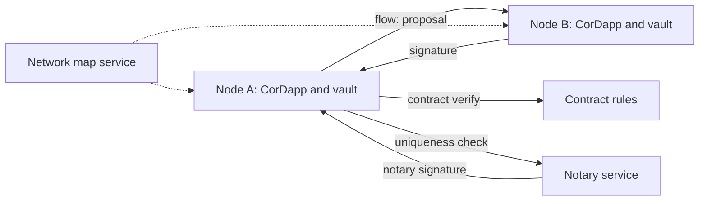

**In simple words:** Corda is a business blockchain by R3 with no global ledger. Each organization keeps its own vault and shares a deal only with the parties involved. <Cite id="class-bt-m4" loc="slide 86" /> <Cite id="class-bt-m4" loc="slide 90" />

**Four layers:** a data layer of immutable states, a contract layer for business rules, a flow layer that automates workflows between parties, and a consensus layer run by a notary that prevents double spending. <Cite id="class-bt-m4" loc="slide 91" />

**Core components:** <Cite id="class-bt-m4" loc="slide 92" />

1. **Node.** Each participant runs a node that hosts CorDapps (the business applications), manages data and talks to counterparties. It keeps a **vault**, a private database of current and consumed states it is party to. Nodes communicate only through flows. <Cite id="class-bt-m4" loc="slide 93" /> <Cite id="class-bt-m4" loc="slide 94" />
2. **Notary service.** Guarantees uniqueness: the input states have not been consumed before. If clean, it signs; if not, the transaction is rejected. Notary clusters use Byzantine fault tolerant consensus. <Cite id="class-bt-m4" loc="slide 95" /> <Cite id="class-bt-m4" loc="slide 96" />
3. **States.** Immutable records of shared facts. A change consumes the old state and creates a new one. Life cycle: issued, evolved, consumed. <Cite id="class-bt-m4" loc="slide 97" /> <Cite id="class-bt-m4" loc="slide 98" />
4. **Contracts.** Rules for valid state changes, written in Kotlin or Java and run in a sandbox. <Cite id="class-bt-m4" loc="slide 99" />
5. **Flows.** Scripts that let nodes build, negotiate and finalize a transaction without a central controller. <Cite id="class-bt-m4" loc="slide 100" />

**Network side:** peer-to-peer TLS messaging, a network map directory, X.509 identity certificates from a CA, and a permissioned network run by an operator. <Cite id="class-bt-m4" loc="slide 101" /> <Cite id="class-bt-m4" loc="slide 102" />

**Transaction flow:** proposal, counterparty verification, contract validation, notary check, finalization, and vault update in both nodes. <Cite id="class-bt-m4" loc="slide 103" /> <Cite id="class-bt-m4" loc="slide 104" /> <Cite id="class-bt-m4" loc="slide 105" />

**Extend in the exam (add these to reach 10 marks):**

- **Why different.** Privacy, scalability (traffic only between counterparties) and enterprise compliance (legal identity, legal prose). <Cite id="class-bt-m4" loc="slide 88" /> <Cite id="class-bt-m4" loc="slide 89" />
- **Industries.** Finance, trade finance, insurance, healthcare, supply chain. <Cite id="class-bt-m4" loc="slide 109" />
- **Oracles.** Bring outside facts, such as a rate, into a transaction. <Cite id="corda-ripple-quorum-corda-tech-wp" />
- **Limits.** Smaller community than Ethereum; not for open public coins. <Cite id="corda-ripple-quorum-xoriant-corda" />

**Conclusion:** Corda's states, contracts, flows, notary and vaults give need-to-know sharing with legal fit.
