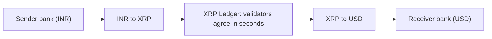

**In simple words:** Ripple is a company and payment network for fast, cheap cross-border transfers. Its native digital asset is XRP. <Cite id="class-bt-m4" loc="slide 72" />

**What it is:** a financial technology company that provides a global payment and settlement network using blockchain. It is closely tied to the XRP Ledger (a decentralized blockchain) and XRP (its native asset), but Ripple itself is not the XRP Ledger. <Cite id="class-bt-m4" loc="slide 73" /> <Cite id="corda-ripple-quorum-xrpl-whatis" />

**How it works:** validators compare proposed transactions with the latest ledger and a majority must accept them. In detail, the XRPL needs about 80 percent of a validator's trusted list to agree. <Cite id="class-bt-m4" loc="slide 80" /> <Cite id="corda-ripple-quorum-xrpl-consensus" />

**Features:** fast processing and settlement, low cost, high throughput, secure, fraud prevention, open-source protocol. <Cite id="class-bt-m4" loc="slide 75" /> <Cite id="class-bt-m4" loc="slide 76" />

**Uses:** cross-border payments, remittances, e-commerce, smart contracts and dApps, liquidity management. <Cite id="class-bt-m4" loc="slide 82" /> <Cite id="class-bt-m4" loc="slide 83" />

**Limitations:** centralization concerns, regulatory uncertainty about XRP, competition and scalability. <Cite id="class-bt-m4" loc="slide 84" /> <Cite id="class-bt-m4" loc="slide 85" />

**Conclusion:** Ripple speeds up international payments with a consensus ledger and a bridge currency. <Cite id="corda-ripple-quorum-gfg-ripple" />
