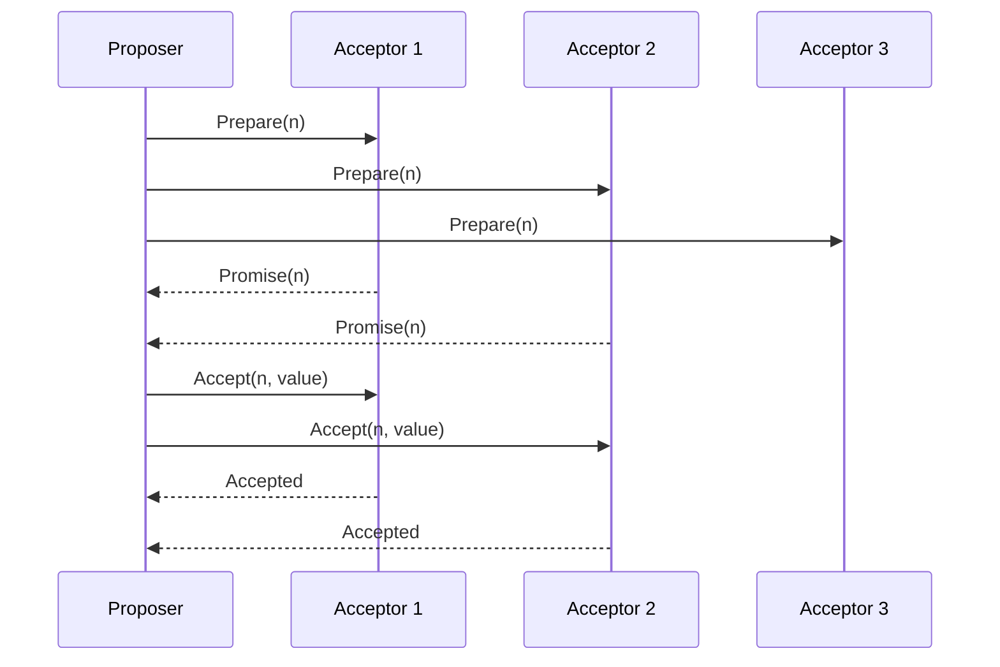

**In simple words:** Paxos lets a group of computers agree on one value even if some crash or messages are lost, as long as a majority is alive. <Cite id="class-bt-m4" loc="slide 70" /> <Cite id="bft-paxos-raft-paxos-simple" />

**Why needed:** a private blockchain has no mining. If two nodes propose different blocks, the group still needs one answer. Paxos gives it. It was invented by Leslie Lamport and handles crash faults only. <Cite id="bft-paxos-raft-wiki-paxos" />

**Roles:** **Proposer** suggests a value (a block), **Acceptor** votes on proposals, **Learner** finds out the chosen value. One node can play all three.

**How it works (two phases):**

1. **Prepare.** The proposer picks a unique number n and sends PREPARE(n) to the acceptors.
2. **Promise.** An acceptor that has not seen a higher number replies PROMISE(n), promises to ignore lower numbers, and reports any value it already accepted.
3. **Accept request.** After promises from a majority, the proposer sends ACCEPT(n, value). If an acceptor reported an accepted value, the proposer must use the one with the highest number.
4. **Accepted.** Acceptors accept unless they promised a higher number, and tell the learners.
5. **Chosen.** When a majority accept the same value, it is decided. <Cite id="bft-paxos-raft-gfg-paxos" />

**Example (5 acceptors):** majority is 3. P1 gets 3 promises, sends Accept(1, X) and 3 accept, so X is chosen. Later P2 sends Prepare(2); at least one promise reports X, so P2 must propose X. The group stays at X.

**Extend in the exam (add these to reach 10 marks):**

- **Why the highest-value rule.** Any two majorities of 5 share at least one node, so a later proposer always meets an acceptor that knows the chosen value. <Cite id="bft-paxos-raft-paxos-simple" />
- **Fault tolerance.** 2f + 1 nodes survive f crashes.
- **Paxos versus Raft.** Raft uses a strong leader and is easier to learn; Paxos has competing proposers that can livelock. <Cite id="bft-paxos-raft-raft-paper" />
- **Limits.** Hard to understand and not safe against lying nodes; PBFT handles those (see Module 2). <Cite id="class-bt-m2" loc="slide 76" />
- **In blockchains.** Known nodes use Paxos or Raft instead of mining. <Cite id="private-blockchain-wiki-paxos" />

**Conclusion:** Paxos uses prepare, promise, accept and accepted rounds with a majority to agree on one value.
