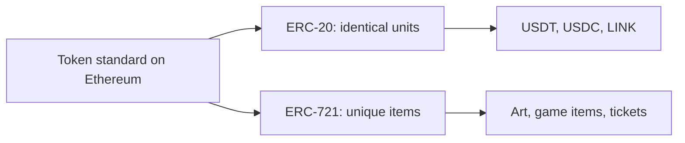

**In simple words:** ERC-20 is the standard for tokens where every unit is the same, like rupee notes. ERC-721 is the standard for unique tokens, like a land deed. <Cite id="class-bt-m5" loc="slide 14" /> <Cite id="class-bt-m5" loc="slide 22" />

**ERC-20 (fungible tokens).** A standard on Ethereum with rules for creating and using fungible tokens, so each token is interchangeable. It appeared because tokens made before 2015 were not interoperable. <Cite id="class-bt-m5" loc="slide 14" /> <Cite id="class-bt-m5" loc="slide 15" />

1. **Functions:** totalSupply, balanceOf, transfer, approve, allowance, transferFrom. <Cite id="class-bt-m5" loc="slide 16" /> <Cite id="class-bt-m5" loc="slide 19" />
2. **Events:** Transfer and Approval. <Cite id="class-bt-m5" loc="slide 17" />
3. **Benefits:** standardization, easy integration, interoperability, easy to create, transparency. <Cite id="class-bt-m5" loc="slide 20" />
4. **Examples:** exchange tokens, game currencies, dollar-valued tokens issued by Circle. <Cite id="class-bt-m5" loc="slide 21" />

**ERC-721 (non-fungible tokens, NFTs).** Each token is unique and individually identifiable by its Token ID. <Cite id="class-bt-m5" loc="slide 22" />

1. **Functions:** balanceOf, ownerOf, transferFrom, safeTransferFrom, approve, getApproved, setApprovalForAll, isApprovedForAll. <Cite id="class-bt-m5" loc="slide 24" /> <Cite id="class-bt-m5" loc="slide 25" />
2. **Events:** Transfer, Approval, ApprovalForAll.
3. **Example:** artwork with Token ID 101: Alice owns it, approves Bob, Bob transfers it and ownerOf(101) now returns Bob. <Cite id="class-bt-m5" loc="slide 27" />
4. **Uses:** digital art, game items, certificates, virtual land, tickets, collectibles. <Cite id="class-bt-m5" loc="slide 29" />

| Point | ERC-20 | ERC-721 |
|---|---|---|
| Token type | Fungible | Non-fungible |
| Identity | All units same | Unique Token ID |
| Divisible | Yes | No, owned whole |
| Balance | One number per address | List of owned token IDs |
| Key functions | transfer, approve, allowance, transferFrom | ownerOf, safeTransferFrom, approve, getApproved |
| Use | Currency, utility, stablecoins | Art, game items, tickets |
| Examples | USDT, USDC, LINK | CryptoKitties, art NFTs |

<Cite id="cryptocurrencies-tokens-gfg-erc-vs" />

**Extend in the exam (add these to reach 10 marks):**

- **approve and transferFrom.** They let a contract (for example an exchange) spend tokens up to an allowance. <Cite id="cryptocurrencies-tokens-eip20" />
- **Metadata.** ERC-721 uses a tokenURI that points to the image or file, usually stored off chain. <Cite id="cryptocurrencies-tokens-eip721" /> <Cite id="web-bt-2-eth-erc721" />
- **Benefits of ERC-721.** Uniqueness, verifiable ownership, standardization, marketplace support. <Cite id="class-bt-m5" loc="slide 28" />
- **One contract.** An ERC-20 contract holds one kind of token; an ERC-721 contract holds many unique tokens. <Cite id="cryptocurrencies-tokens-eth-erc721" />

**Conclusion:** ERC-20 suits money-like tokens; ERC-721 suits unique items. <Cite id="cryptocurrencies-tokens-eth-erc20" />
